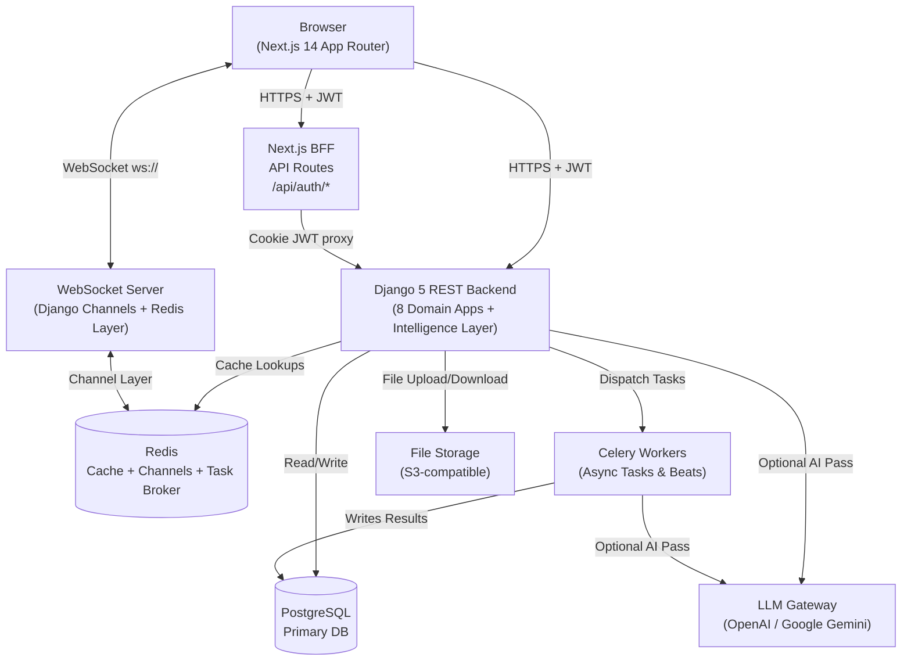
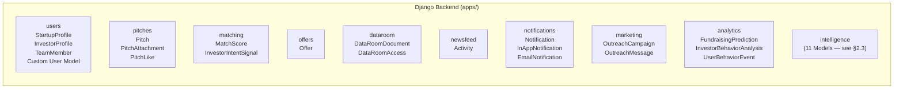
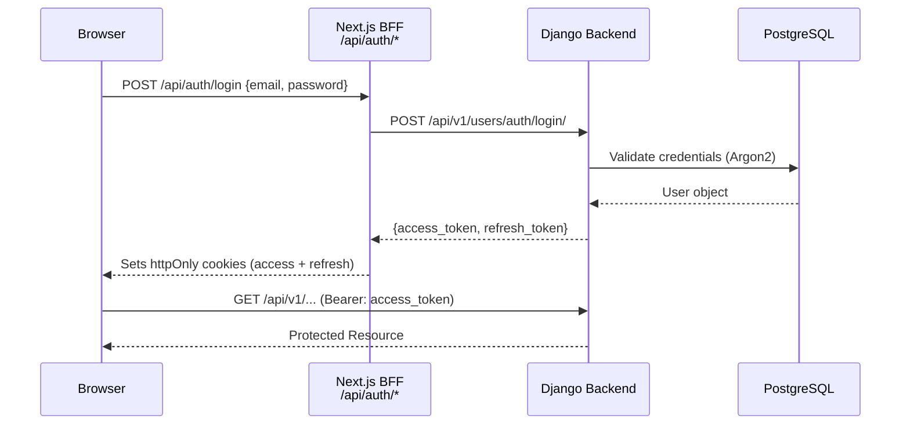
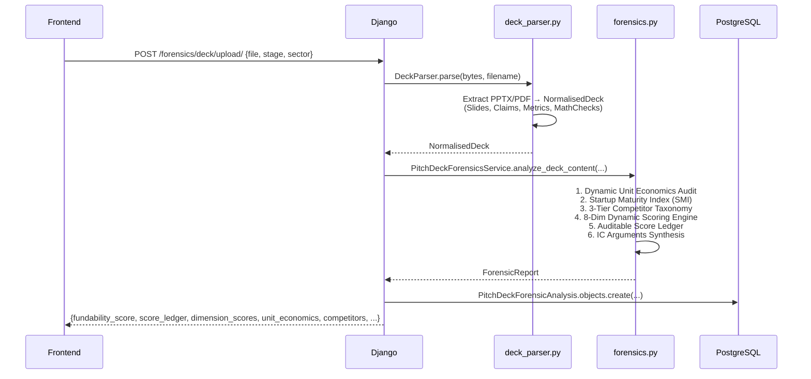
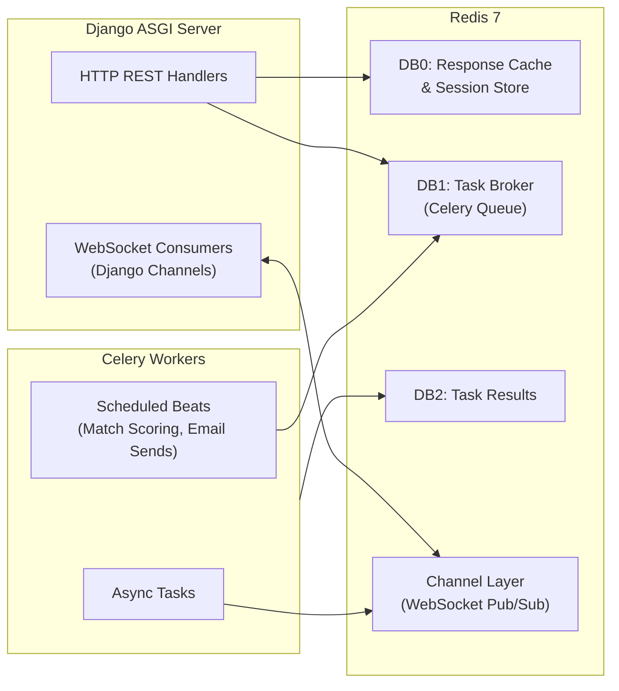
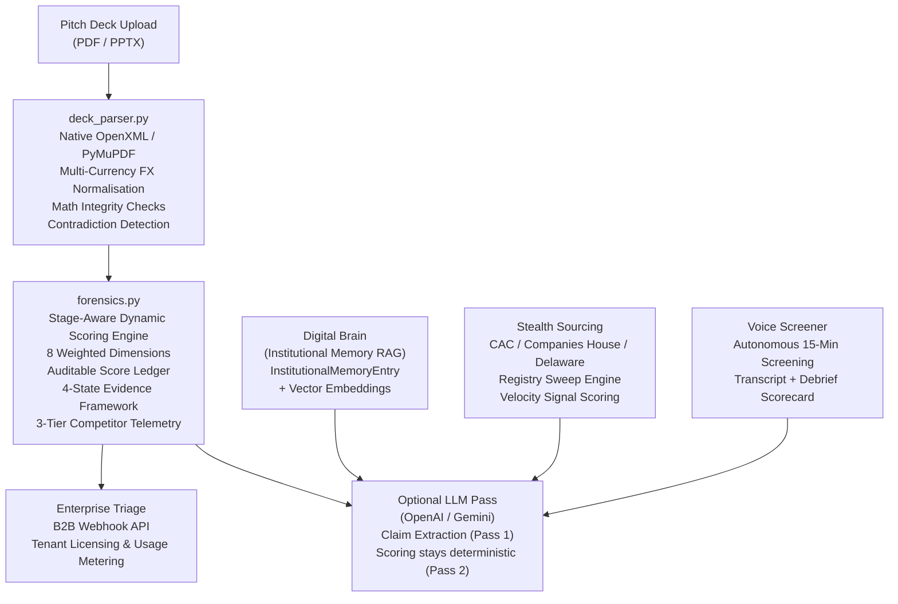
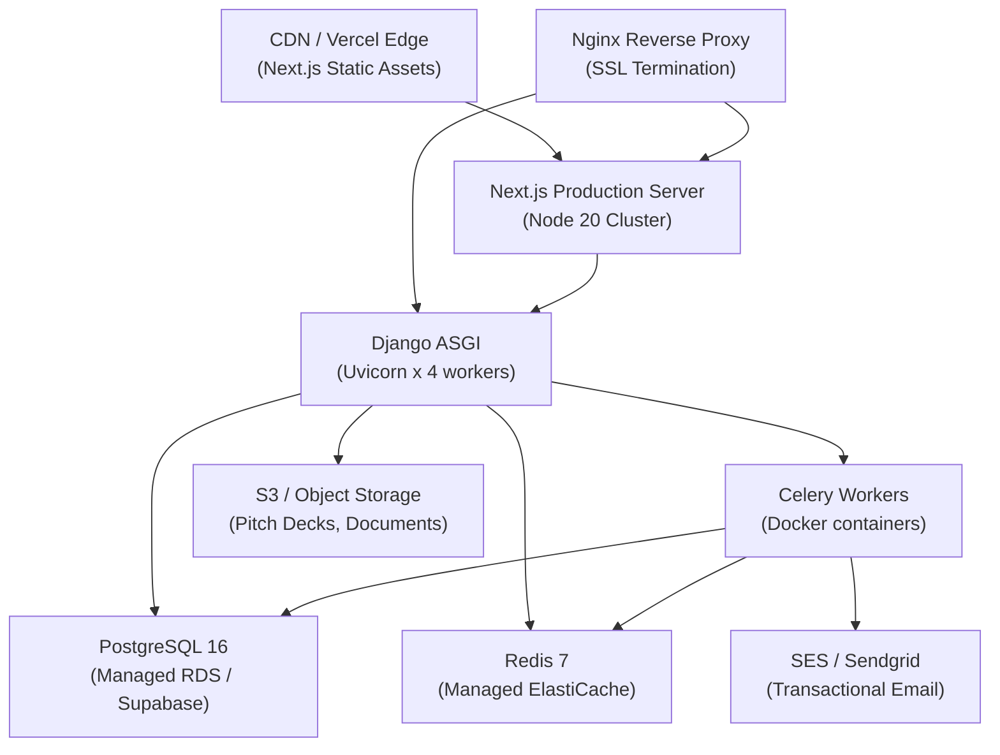

# Pitchmic — Full Architectural Design

> **Platform Category**: AI-Native Venture Capital Intelligence & Founder-Investor Networking Platform  
> **Runtime Stack**: Django 5 / Next.js 14 / PostgreSQL / Redis / Celery / WebSockets (Django Channels)

---

## 1. System Overview

Pitchmic is a two-sided marketplace and intelligence platform connecting **startup founders** seeking capital with **institutional investors** (VCs, Angels, Accelerators). It layers a full AI intelligence engine on top of the core networking workflows.



---

## 2. Backend — Django Application Architecture

### 2.1 Configuration Layer

| Component | Technology | Notes |
| :--- | :--- | :--- |
| Web Server | **Django 5 + ASGI (Uvicorn)** | Handles both HTTP REST and WebSocket connections |
| Task Queue | **Celery 5 + django-celery-beat** | Async processing, scheduled intelligence runs |
| Message Broker | **Redis 7** (3 databases) | `0`: Cache, `1`: Celery Broker, `2`: Result Backend |
| Real-Time Layer | **Django Channels 4 + channels-redis** | InMemory fallback locally, Redis in production |
| Auth | **djangorestframework-simplejwt** | Access + Refresh Tokens, Argon2 password hashing |
| CORS | **django-cors-headers** | Localhost dev origins + configurable production origins |
| Database ORM | **Django ORM + psycopg2** | SQLite in dev, PostgreSQL in production |
| LLM Gateway | **OpenAI SDK + Google Gemini API** | Optional; deterministic scoring runs without LLM |

---

### 2.2 Domain Application Map



---

### 2.3 Intelligence App — Model Taxonomy

The intelligence app is the largest and most complex domain. It contains **11 models** across 5 functional pillars:

```mermaid
erDiagram
    %% Forensic Underwriting
    PitchDeckForensicAnalysis {
        int id
        fk startup
        string company_name
        float fundability_score
        json unit_economics_audit
        json competitor_benchmarks
        json verified_claims
        text bull_thesis
        text bear_thesis
        json missing_critical_slides
        json raw_extraction
    }

    %% Multi-Agent AI Predictions
    StartupSuccessPrediction {
        int id
        fk startup
        float overall_score
        json dimension_scores
        json agents_result
        json recommendations
    }

    %% IC Memo
    DueDiligenceReport {
        int id
        fk startup
        string status
        json debate_transcript
        text final_memo
    }

    %% Stealth Founder Sourcing
    StealthFounderSignal {
        int id
        string founder_name
        string company_name
        string signal_type
        float confidence
        string jurisdiction
        json metadata
    }

    %% Institutional Memory (RAG)
    InstitutionalMemoryEntry {
        int id
        string company_name
        string source_type
        text summary
        text content
        json tags
        string verdict
        vector embedding
    }

    %% Voice Screening
    VoiceInterviewSession {
        int id
        fk startup
        string stage
        string persona
        string status
        json transcript
        json debrief_scorecard
    }

    %% B2B Licensing
    EnterpriseTenant {
        int id
        string name
        string slug
        string tier
        int monthly_deal_quota
        string webhook_url
    }

    TenantAPIKey {
        int id
        fk tenant
        string key_prefix
        string key_hash
        bool is_active
    }

    TenantUsageLog {
        int id
        fk tenant
        string endpoint
        int tokens_used
    }

    PredictionFeedback { int id }
    ModelPerformanceTracker { int id }
```

---

### 2.4 API Endpoint Contract

| App | Route | Method | Purpose |
| :--- | :--- | :--- | :--- |
| **auth (users)** | `/api/v1/users/auth/login/` | POST | JWT Login |
| | `/api/v1/users/auth/register/` | POST | Register Startup or Investor |
| | `/api/v1/users/auth/refresh/` | POST | Rotate Access Token |
| | `/api/v1/users/profile/me/` | GET/PATCH | Current User Profile |
| **pitches** | `/api/v1/pitches/` | GET/POST | List & Create Pitches |
| | `/api/v1/pitches/<id>/` | GET/PUT/DELETE | Pitch Detail & CRUD |
| **matching** | `/api/v1/matching/top/` | GET | Top Investor-Startup Matches |
| | `/api/v1/matching/refresh/` | POST | Trigger Match Score Recalculation |
| **offers** | `/api/v1/offers/` | GET/POST | Investment Offers |
| **dataroom** | `/api/v1/dataroom/` | GET/POST | Document Upload |
| | `/api/v1/dataroom/<id>/grant/` | POST | NDA + Access Grant |
| **analytics** | `/api/v1/analytics/predict/` | POST | Fundraising Readiness Score |
| | `/api/v1/analytics/behavior/` | POST | Investor Heatmap Telemetry |
| **intelligence** | `/api/v1/intelligence/forensics/deck/upload/` | POST | Stage-Aware Deck Underwriting |
| | `/api/v1/intelligence/forensics/deck/` | POST | Text-based Deck Analysis |
| | `/api/v1/intelligence/due-diligence/` | POST | Multi-Agent IC Memo |
| | `/api/v1/intelligence/due-diligence/<id>/debate/` | POST | Debate Mode (Bull vs Bear) |
| | `/api/v1/intelligence/brain/query/` | POST | Institutional Memory Query |
| | `/api/v1/intelligence/brain/ingest/` | POST | Ingest to Memory |
| | `/api/v1/intelligence/stealth/signals/` | GET | Stealth Founder Signals |
| | `/api/v1/intelligence/stealth/discover/` | POST | Trigger Registry Sweep |
| | `/api/v1/intelligence/voice/start/` | POST | Start Voice Screening Session |
| | `/api/v1/intelligence/voice/<id>/turn/` | POST | Submit Transcript Turn |
| | `/api/v1/intelligence/voice/<id>/debrief/` | POST | Generate Debrief Scorecard |
| | `/api/v1/intelligence/tenants/` | GET/POST | B2B Enterprise Tenants |
| | `/api/v1/intelligence/tenants/<id>/keys/` | POST | Provision API Key |
| | `/api/v1/intelligence/webhook/triage/` | POST | Partner Triage Webhook |

---

## 3. Frontend — Next.js 14 App Router Architecture

### 3.1 Layout Groups

```
src/app/
 layout.tsx                  ← Root Layout (providers, fonts, global CSS)
 page.tsx                    ← Landing / Root redirect
 not-found.tsx               ← Custom 404
 globals.css
 providers.tsx               ← React Context Providers tree

 (auth)/                     ← Auth Layout Group (MarketingShell)
    sign-in/page.tsx
    sign-up/[role]/page.tsx
    verify/[token]/page.tsx

 (dashboard)/                ← Protected Dashboard Layout Group
    layout.tsx              ← Sidebar + Navbar shell
    newsfeed/page.tsx
    discover/page.tsx
    pitches/page.tsx
    pitches/new/page.tsx
    offers/page.tsx
    messages/page.tsx
    dataroom/page.tsx
    campaigns/page.tsx
    notifications/page.tsx
    analytics/page.tsx
    settings/page.tsx
    upgrade/page.tsx
    company/page.tsx
    profile/edit/page.tsx
    profile/avatar/page.tsx
    profile/logo/page.tsx
    intelligence/page.tsx   ← VC Intelligence & Forensics Hub

 api/auth/                   ← Next.js BFF Cookie Management
     login/route.ts          ← Sets httpOnly JWT cookies
     logout/route.ts
     refresh/route.ts
     register/route.ts
     verify/route.ts
```

### 3.2 Key Library Modules

| Module | Purpose |
| :--- | :--- |
| `src/lib/api.ts` | Base Axios/fetch API client (attaches JWT, handles 401 refresh loops) |
| `src/lib/intelligenceApi.ts` | Typed intelligence endpoints + all TypeScript interfaces |
| `src/lib/validators.ts` | Zod schemas for form validation (SignIn, SignUp, Pitch) |
| `src/hooks/useAuth.ts` | Auth context: login, logout, token refresh, session state |
| `src/hooks/useWebSocket.ts` | Real-time WebSocket connection management |

### 3.3 Component Library

```
src/components/
 ui/              ← Primitive Design System
    Button        Card           Badge
    Input         Label          Separator
    Sheet         DropdownMenu   Logo
    Toast         ...
 layout/          ← Shell Components
    Sidebar.tsx   (Persistent left navigation)
    Navbar.tsx    (Top bar with notifications + profile)
    MarketingShell.tsx (Auth page wrapper)
 analytics/       ← Dashboard Components
    SuccessPredictorDashboard.tsx
    InvestorROIDashboard.tsx
 pitches/         ← Pitch-specific Components
 newsfeed/        ← Activity Feed Components
 offers/          ← Offer Card Components
```

---

## 4. Data Flow Architecture

### 4.1 Authentication Flow



### 4.2 Pitch Deck Forensic Underwriting Flow



---

## 5. Real-Time & Async Infrastructure



**Real-time Use Cases:**
- Live notification delivery to connected investors
- Real-time matching score updates after profile edits
- Voice screening session turn streaming
- Live pitch activity feed updates

---

## 6. AI/Intelligence Layer Architecture



**Zero-Fake-AI Principle:** All scoring and mathematical verification is deterministic. LLM is used optionally for natural-language claim extraction in Pass 1 only. The final score is always an exact auditable calculation.

---

## 7. Security Architecture

| Layer | Mechanism |
| :--- | :--- |
| **Auth** | JWT Access Tokens (15 min TTL) + httpOnly Refresh Cookies (7 day TTL) |
| **Password Hashing** | Argon2 (primary) → PBKDF2 → BCrypt (fallback chain) |
| **API Authorization** | `IsAuthenticated` default; `AllowAny` only on webhook & upload endpoints |
| **CORS** | Strict origin allowlist; `CORS_ALLOW_CREDENTIALS = True` |
| **Token Blacklist** | `rest_framework_simplejwt.token_blacklist` tracks invalidated tokens |
| **Data Isolation** | All queries scoped to `request.user`; no cross-tenant data leakage |
| **File Validation** | MIME type + extension validation before deck parse |
| **B2B API Keys** | Hashed key storage; prefix-based fast lookup; provisioning audit logs |

---

## 8. Deployment Topology (Production)



---

## 9. Summary Table — Platform Capabilities

| Feature | Status | Key Technology |
| :--- | :--- | :--- |
| Startup & Investor profiles |  Live | Django users app, Next.js profile pages |
| Pitch creation & management |  Live | pitches app, S3 file storage |
| AI-powered investor matching |  Live | matching app, MatchScore model |
| Investment offers & negotiation |  Live | offers app |
| NDA-gated secure data room |  Live | dataroom app, signed NDA flow |
| Activity newsfeed |  Live | newsfeed app, real-time WebSocket |
| Smart outreach campaigns |  Live | marketing app, Celery async sends |
| Fundraising analytics dashboard |  Live | analytics app, prediction engine |
| Forensic pitch deck underwriting |  Live | intelligence/forensics.py (dynamic v2) |
| Institutional memory (RAG Brain) |  Live | InstitutionalMemoryEntry + embeddings |
| Stealth founder radar |  Live | StealthFounderSignal, registry sweep |
| Autonomous voice screening |  Live | VoiceInterviewSession |
| B2B enterprise licensing & API |  Live | EnterpriseTenant, TenantAPIKey metering |
| Real-time notifications |  Live | Django Channels + Redis |

---

## Getting Started

### Prerequisites

- Python 3.11+
- Node.js 20+
- PostgreSQL 16+ (or SQLite for local dev)
- Redis 7+

### 1. Backend Setup

```bash
cd backend
python -m venv venv

# Linux/macOS:
source venv/bin/activate
# Windows:
venv\Scripts\activate

pip install -r requirements.txt
cp ../.env.example ../.env    # Populate your local secrets
python manage.py migrate
python manage.py runserver 0.0.0.0:8000
```

### 2. Celery Worker (background jobs)

```bash
cd backend
celery -A config worker --loglevel=info
```

### 3. Frontend Setup

```bash
cd frontend
npm install
npm run dev
```

- **Web App**: `http://localhost:3000`
- **Backend API**: `http://localhost:8000`
- **Swagger / API Docs**: `http://localhost:8000/api/docs/`

---

## Environment Variables

| Variable | Description | Default |
| :--- | :--- | :--- |
| `SECRET_KEY` | Django cryptographic signing key | Required |
| `DATABASE_URL` | PostgreSQL connection string | `sqlite:///db.sqlite3` |
| `REDIS_URL` | Redis URL (cache, channels, broker) | `redis://127.0.0.1:6379/0` |
| `CELERY_BROKER_URL` | Celery task broker | `redis://localhost:6379/1` |
| `OPENAI_API_KEY` | OpenAI API key (optional — scoring is deterministic without it) | `""` |
| `GOOGLE_GEMINI_API_KEY` | Google Gemini API key (optional) | `""` |
| `NEXT_PUBLIC_API_URL` | Backend base URL for Next.js | `http://localhost:8000` |
| `CORS_ALLOWED_ORIGINS` | Comma-separated allowed frontend origins | `http://localhost:3000` |

---

## Quality & Verification

```bash
# Backend tests
cd backend && pytest

# Frontend TypeScript check
cd frontend && npx tsc --noEmit

# Frontend production build
cd frontend && npm run build
```

---

## Deployment Topology (Production)

```
CDN / Vercel Edge (Static Assets)
        
        
Nginx Reverse Proxy (SSL Termination)
        
         Next.js (Node 20 Cluster)
         Django ASGI (Uvicorn × 4 Workers)
                
                 PostgreSQL (Managed RDS / Supabase)
                 Redis 7 (Managed ElastiCache)
                 Celery Workers (Docker containers)
                 S3 / Object Storage (Decks, Documents)
                 Email (SES / Sendgrid)
```

---

## License

Proprietary. All rights reserved.
