# Pitchmic — Full Architectural Design

> **Platform Category**: AI-Native Venture Capital Intelligence & Founder-Investor Networking Platform
> **Runtime Stack**: Django 5 / Next.js 14 / FastAPI ML Service / PostgreSQL / Redis / Celery / WebSockets

---

## 1. System Overview

Pitchmic is a two-sided marketplace and intelligence platform connecting **startup founders** seeking capital with **institutional investors** (VCs, Angels, Accelerators). It layers a full AI + ML intelligence engine on top of the core networking workflows.

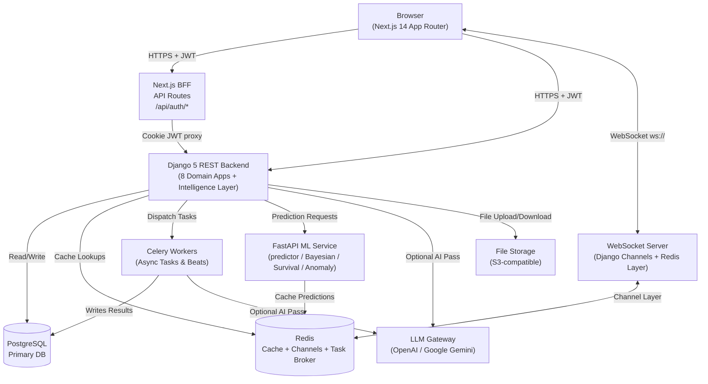

---

## 2. Backend — Django Application Architecture

### 2.1 Configuration Layer

| Component | Technology | Notes |
| :--- | :--- | :--- |
| Web Server | **Django 5 + ASGI (Uvicorn)** | HTTP REST and WebSocket |
| Task Queue | **Celery 5 + django-celery-beat** | Async processing, scheduled runs |
| Message Broker | **Redis 7** (3 DBs) | `0` Cache, `1` Broker, `2` Results |
| Real-Time | **Django Channels 4 + channels-redis** | Redis in production |
| Auth | **djangorestframework-simplejwt** | Access + Refresh tokens, Argon2 |
| CORS | **django-cors-headers** | Configurable origin allowlist |
| ORM | **Django ORM + psycopg2** | SQLite dev / PostgreSQL prod |
| LLM Gateway | **OpenAI SDK + Google Gemini** | Optional; scoring is deterministic |

---

### 2.2 Domain Application Map

```mermaid
flowchart LR
    subgraph BACKEND["Django Backend (apps/)"]
        direction TB
        users[" users\nStartupProfile\nInvestorProfile\nTeamMember\nCustom User Model"]
        pitches[" pitches\nPitch\nPitchAttachment\nPitchLike"]
        matching[" matching\nMatchScore\nInvestorIntentSignal"]
        offers[" offers\nOffer\nWebSocket Bid Consumer"]
        dataroom[" dataroom\nDataRoomDocument\nDataRoomAccess\nSlideEngagementLog"]
        newsfeed[" newsfeed\nActivity"]
        notifications[" notifications\nNotification\nInAppNotification\nEmailNotification"]
        marketing[" marketing\nOutreachCampaign\nOutreachMessage"]
        analytics[" analytics\nFundraisingPrediction\nInvestorBehaviorAnalysis\nUserBehaviorEvent"]
        intelligence[" intelligence\n11 Models + ML Sub-Package"]
        predictive[" predictive_intelligence\nAI Provider Gateway\nCapability Routing\nUsage Metering"]
    end
```

---

### 2.3 Intelligence App — Model Taxonomy

The intelligence app is the largest and most complex domain. It contains **11+ models** across 5 functional pillars, backed by a dedicated ML sub-package (§5).

```mermaid
erDiagram
    PitchDeckForensicAnalysis {
        int id
        fk startup
        float fundability_score
        json unit_economics_audit
        json competitor_benchmarks
        json verified_claims
        text bull_thesis
        text bear_thesis
        json score_ledger
        json raw_extraction
    }

    StartupSuccessPrediction {
        int id
        fk startup
        float overall_score
        json dimension_scores
        json agents_result
        json recommendations
    }

    DueDiligenceReport {
        int id
        fk startup
        string status
        json debate_transcript
        text final_memo
    }

    StealthFounderSignal {
        int id
        string founder_name
        string company_name
        string signal_type
        float confidence
        string jurisdiction
        json metadata
    }

    InstitutionalMemoryEntry {
        int id
        string company_name
        string source_type
        text summary
        text content
        json tags
        string verdict
        vector embedding
    }

    VoiceInterviewSession {
        int id
        fk startup
        string stage
        string persona
        string status
        json transcript
        json debrief_scorecard
    }

    EnterpriseTenant {
        int id
        string name
        string slug
        string tier
        int monthly_deal_quota
        string webhook_url
    }

    TenantAPIKey {
        int id
        fk tenant
        string key_prefix
        string key_hash
        bool is_active
    }

    VentureOutcomeRecord {
        int id
        fk startup
        float series_a_prob
        float unicorn_prob
        json survival_curve
        json bayesian_belief
    }

    EvidenceClaimRecord {
        int id
        fk forensics_analysis
        string claim_text
        string evidence_state
        float confidence
    }
```

---

### 2.4 API Endpoint Contract

| App | Route | Method | Purpose |
| :--- | :--- | :--- | :--- |
| **auth** | `/api/v1/users/auth/login/` | POST | JWT Login |
| | `/api/v1/users/auth/register/` | POST | Register |
| | `/api/v1/users/auth/refresh/` | POST | Rotate Access Token |
| | `/api/v1/users/profile/me/` | GET/PATCH | Current User Profile |
| **pitches** | `/api/v1/pitches/` | GET/POST | List & Create |
| | `/api/v1/pitches/<id>/` | GET/PUT/DELETE | Detail & CRUD |
| **matching** | `/api/v1/matching/top/` | GET | Top Matches |
| | `/api/v1/matching/refresh/` | POST | Recalculate Scores |
| **offers** | `/api/v1/offers/` | GET/POST | Investment Offers |
| **dataroom** | `/api/v1/dataroom/` | GET/POST | Document Upload |
| | `/api/v1/dataroom/<id>/grant/` | POST | NDA + Access Grant |
| **analytics** | `/api/v1/analytics/predict/` | POST | Fundraising Readiness Score |
| | `/api/v1/analytics/behavior/` | POST | Investor Heatmap Telemetry |
| **intelligence** | `/api/v1/intelligence/forensics/deck/upload/` | POST | Deck Underwriting |
| | `/api/v1/intelligence/forensics/deck/` | POST | Text-based Analysis |
| | `/api/v1/intelligence/due-diligence/` | POST | Multi-Agent IC Memo |
| | `/api/v1/intelligence/due-diligence/<id>/debate/` | POST | Bull vs Bear Debate |
| | `/api/v1/intelligence/brain/query/` | POST | RAG Memory Query |
| | `/api/v1/intelligence/brain/ingest/` | POST | Ingest to Memory |
| | `/api/v1/intelligence/stealth/signals/` | GET | Stealth Founder Signals |
| | `/api/v1/intelligence/stealth/discover/` | POST | Registry Sweep |
| | `/api/v1/intelligence/voice/start/` | POST | Start Voice Session |
| | `/api/v1/intelligence/voice/<id>/turn/` | POST | Submit Transcript Turn |
| | `/api/v1/intelligence/voice/<id>/debrief/` | POST | Debrief Scorecard |
| | `/api/v1/intelligence/tenants/` | GET/POST | Enterprise Tenants |
| | `/api/v1/intelligence/tenants/<id>/keys/` | POST | Provision API Key |
| | `/api/v1/intelligence/webhook/triage/` | POST | Partner Triage Webhook |

---

## 3. Frontend — Next.js 14 App Router

### 3.1 Route Structure

```
src/app/
 layout.tsx                      Root Layout
 page.tsx                        Landing page
 not-found.tsx                   Custom 404
 providers.tsx                   Context provider tree

 (auth)/                         Auth Layout Group (MarketingShell)
    sign-in/page.tsx
    sign-up/[role]/page.tsx
    verify/[token]/page.tsx

 (dashboard)/                    Protected Layout Group (Sidebar + Navbar)
    layout.tsx
    newsfeed/           discover/          pitches/
    pitches/new/        pitches/[id]/      pitches/[id]/edit/
    offers/             messages/          dataroom/
    campaigns/          notifications/     analytics/
    intelligence/       fundability/       accelerator/
    admin/              settings/          upgrade/
    company/            profile/edit/
    profile/avatar/     profile/logo/

 api/auth/                       Next.js BFF (httpOnly cookie management)
     login/route.ts
     logout/route.ts
     refresh/route.ts
     register/route.ts
     verify/route.ts
     me/route.ts
```

### 3.2 Key Library Modules

| Module | Purpose |
| :--- | :--- |
| `src/lib/api.ts` | Axios client — attaches JWT, handles 401 refresh loops |
| `src/lib/intelligenceApi.ts` | Typed intelligence endpoints + TypeScript interfaces |
| `src/lib/validators.ts` | Zod schemas (SignIn, SignUp, Pitch) |
| `src/lib/types.ts` | Shared TypeScript types |
| `src/hooks/useAuth.tsx` | Auth context: login, logout, refresh, session state |
| `src/hooks/useNewsfeed.ts` | Paginated newsfeed with infinite scroll |
| `src/hooks/useNotifications.ts` | Real-time notification subscription |
| `src/hooks/useInfiniteScroll.ts` | Intersection Observer scroll hook |

### 3.3 Component Library

```
src/components/
 ui/              Button  Card  Badge  Input  Label  Separator
                  Sheet   DropdownMenu  Logo   Avatar  Textarea  Tooltip
 layout/          Sidebar  Navbar  DashboardShell  MarketingShell  Footer
 analytics/       SuccessPredictorDashboard  InvestorROIDashboard  InvestmentHeatmap
 pitches/         LikeButton
 newsfeed/        PitchCard
 offers/          OfferRow  BidPanel
```

---

## 4. ML Service — Standalone FastAPI Microservice

The ML service (`ml/`) runs as a **separate Docker container** with its own FastAPI app, Redis cache, and Prometheus metrics endpoint.

```
ml/
├── main.py                  FastAPI entry-point
├── predictor.py             Core 30-feature prediction orchestrator
├── api/
│   └── app.py               Application factory (rate limiter, metrics middleware)
├── config/
│   └── settings.py          Pydantic-settings (env-var driven)
├── models/
│   ├── registry.py          Versioned model registry (atomic JSON persistence)
│   └── trainer.py           XGBoost training pipeline
├── cache/
│   └── redis_cache.py       Two-tier cache (Redis + in-process LRU)
├── monitoring/
│   ├── metrics.py           Prometheus singletons
│   └── drift.py             Feature drift detection
└── security/
    ├── auth.py              JWT auth + RBAC FastAPI dependencies
    └── rate_limiter.py      Sliding-window rate limiter
```

### 4.1 30-Feature Prediction Schema

| Category | Features |
| :--- | :--- |
| Team | `team_size`, `founder_experience_yrs`, `previous_exits`, `has_linkedin`, `has_github` |
| IP & Press | `patent_count`, `press_count`, `awards_count` |
| Financials | `current_revenue`, `revenue_growth_rate`, `gross_margin`, `runway_months`, `ltv_cac_ratio` |
| Traction | `customer_count`, `mau` |
| Market | `tam`, `sam`, `market_growth_rate` |
| Stage | `stage_seed`, `stage_series_a`, `stage_series_b_plus` |
| Company | `founded_years_ago` |
| Pitch Quality | `pitch_count`, `total_likes`, `total_offers`, `has_problem_section`, `has_solution_section`, `has_traction_section`, `has_financials_section`, `has_video` |

### 4.2 XGBoost Model + Heuristic Fallback

- **Primary**: XGBoost booster loaded from `MODEL_PATH/startup_success.xgb`
- **Fallback**: Weighted heuristic with 17 calibrated per-feature weights, output range `[0.1, 0.9]`
- Hot-reload via background file-watcher (checks every 5 min) without container restart

### 4.3 Circuit Breaker

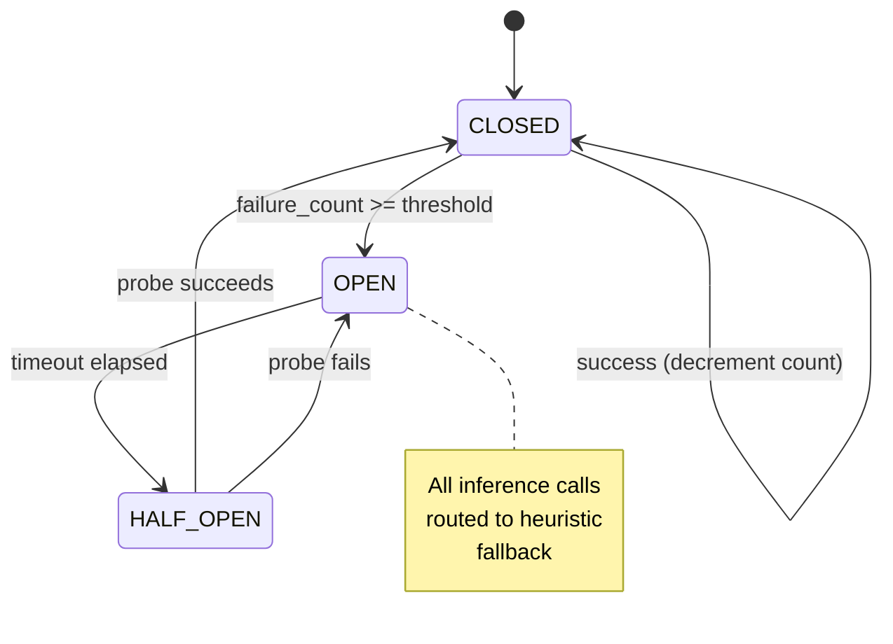

### 4.4 ML API Endpoints

| Route | Method | Purpose |
| :--- | :--- | :--- |
| `/health` | GET | Liveness + model status |
| `/ready` | GET | Kubernetes readiness probe |
| `/metrics` | GET | Prometheus text exposition |
| `/predict/success` | POST | Single startup prediction |
| `/predict/batch` | POST | Parallel batch (up to 100, ThreadPoolExecutor) |
| `/predict/embedding` | POST | Sentence-transformer vector embedding |
| `/model/info` | GET | Feature schema + active version + registry |
| `/model/reload` | POST | Hot-reload model from disk |
| `/api/v1/models/activate` | POST | Activate a registry version (admin only) |
| `/api/v1/models/{version}` | DELETE | Remove a model version (admin only) |

---

## 5. ML Algorithms — Intelligence Sub-Package

The `backend/apps/intelligence/ml/` sub-package provides **five deterministic ML engines**. All produce auditable, explainable outputs with no LLM dependency.

---

### 5.1 Bayesian Update Engine (`ml/bayesian.py`)

**Algorithm**: Beta-Binomial conjugate updating with credible interval approximation.

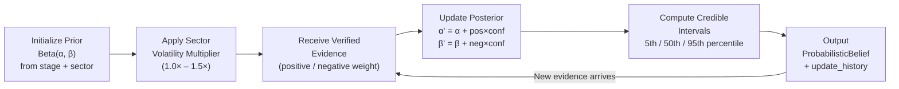

**Stage Priors (α, β)**:

| Stage | α | β | Baseline P |
| :--- | :--- | :--- | :--- |
| Pre-seed | 2.0 | 18.0 | ~10% |
| Seed | 3.0 | 12.0 | ~20% |
| Series A | 5.0 | 10.0 | ~33% |
| Series B | 6.0 | 6.0 | ~50% |

**Sector Volatility Multipliers**:

| Sector | Multiplier | Effect |
| :--- | :--- | :--- |
| consumer | 1.5× | Widest uncertainty |
| climate_hardware | 1.4× | Hardware + policy risk |
| ai_infrastructure | 1.3× | Rapid landscape shifts |
| healthtech | 1.2× | Regulatory uncertainty |
| fintech | 1.1× | Moderate exposure |
| enterprise_saas | 1.0× | Baseline |

**Outputs**: `posterior_probability`, `credible_interval_5/50/95`, `uncertainty_score`, `update_history`

---

### 5.2 Anomaly Detection Engine (`ml/anomalies.py`)

**Algorithm**: Percentile-based statistical outlier detection against empirical sector benchmarks.

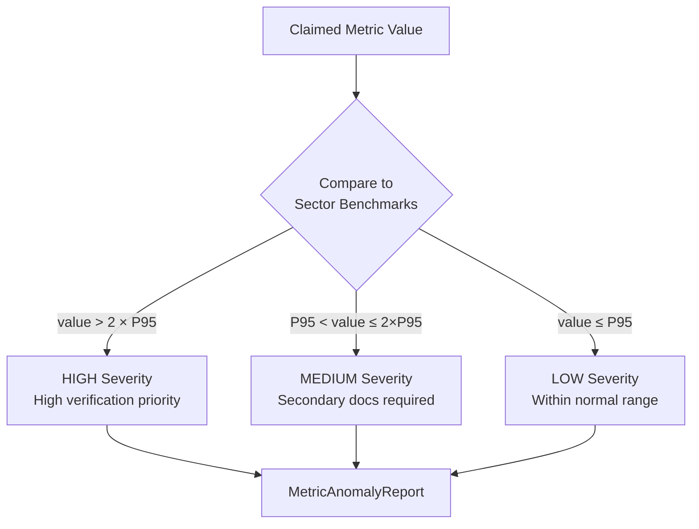

**Benchmark example — `enterprise_saas`**:

| Metric | P25 | Median | P75 | P95 |
| :--- | :--- | :--- | :--- | :--- |
| MoM growth % | 8 | 15 | 25 | 50 |
| Gross margin % | 65 | 78 | 85 | 92 |
| Net revenue retention % | 95 | 110 | 125 | 150 |
| CAC payback months | 6 | 12 | 18 | 24 |

---

### 5.3 Venture Outcome Predictor (`ml/outcomes.py`)

**Algorithm**: Multi-task probabilistic prediction combining Bayesian updating + Weibull survival + anomaly audit.

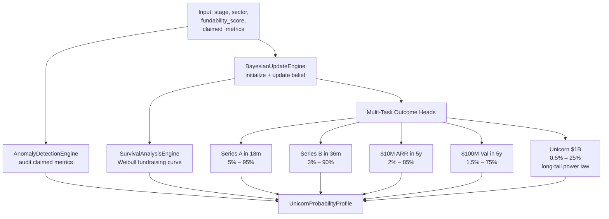

**Confidence tiers**: `VERY_HIGH` (evidence ≥ 85%, uncertainty < 1.0) → `HIGH` → `MODERATE` → `SPECULATIVE`

---

### 5.4 Survival Analysis Engine (`ml/survival.py`)

**Algorithm**: Parametric Weibull hazard model for time-to-fundraising survival curves.

```
F(t) = 1 − exp( −(t / λ)^k )

λ (scale)  = adjusted by traction velocity — faster growth → shorter time to raise
k (shape)  = 1.35 when runway < 12 months (increasing hazard)
           = 1.15 otherwise
h(t)       = (k/λ) × (t/λ)^(k−1)   [instantaneous hazard rate]
```

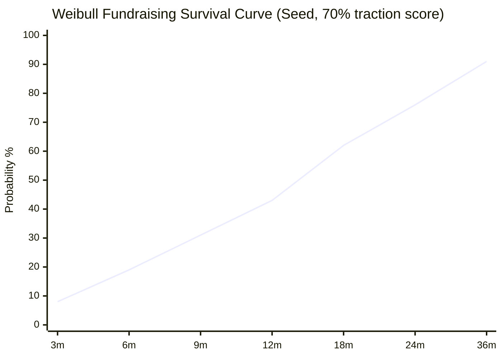

**Horizons**: 3, 6, 9, 12, 18, 24, 36 months — each returns `probability_milestone_achieved` and `hazard_rate`.

---

### 5.5 Behavioral Sequence Model (`ml/sequences.py`)

**Algorithm**: Markov transition journey scoring for investor intent inference.

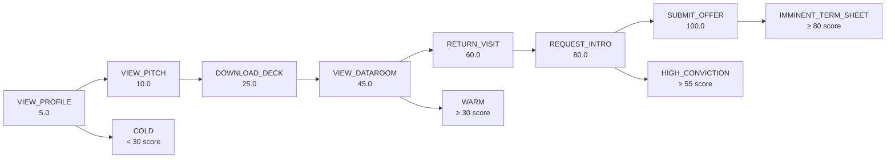

**Velocity factor**: Events compressed into < 7 days earn up to **1.3× conviction multiplier**.

| Score | Tier | Recommended Action |
| :--- | :--- | :--- |
| ≥ 80 | IMMINENT_TERM_SHEET | Prepare partner IC memo + cap table model |
| ≥ 55 | HIGH_CONVICTION | Schedule partner deep-dive diligence call |
| ≥ 30 | WARM | Send updated traction snapshot + references |
| < 30 | COLD | Monitor signals, automated newsletter |

---

### 5.6 Historical Time Machine (`ml/time_machine.py`)

**Algorithm**: Point-in-time temporal filtering + Brier Score calibration evaluator.

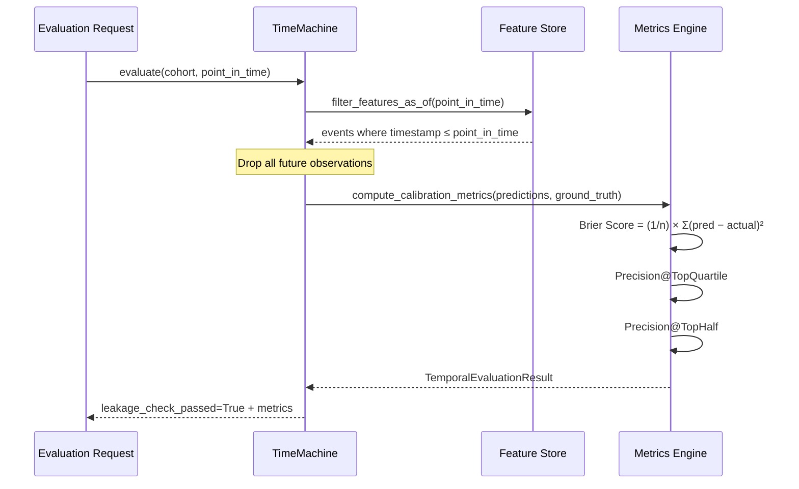

| Metric | Formula | Interpretation |
| :--- | :--- | :--- |
| `brier_score_calibration` | `(1/n) × Σ(pred − actual)²` | 0.0 = perfect |
| `precision_at_top_quartile` | Actual successes in top 25% ranked | Higher = better |
| `precision_at_top_half` | Actual successes in top 50% ranked | Higher = better |
| `pr_auc` | Approximated from Brier score | Discrimination proxy |

---

## 6. ML Security Layer

### 6.1 Rate Limiter (`ml/security/rate_limiter.py`)

**Algorithm**: Sliding-window with atomic Redis Lua script eliminating TOCTOU races.

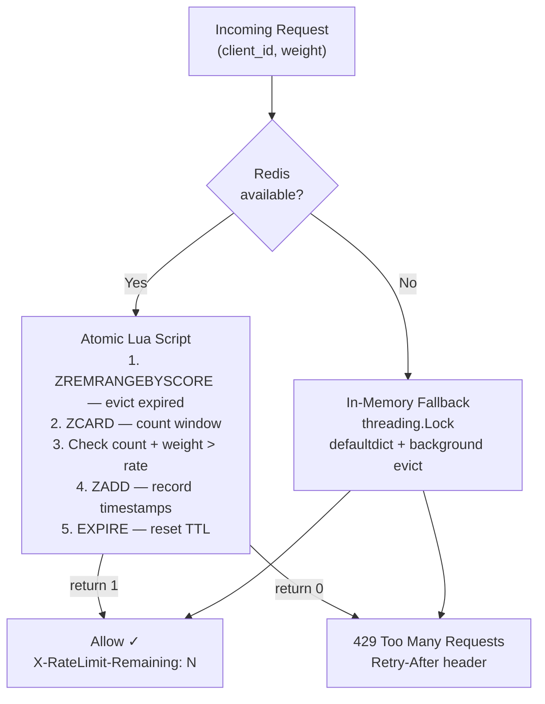

### 6.2 JWT Auth + RBAC (`ml/security/auth.py`)

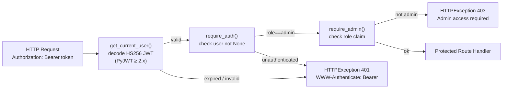

---

## 7. Authentication & Core Data Flows

### 7.1 Login Flow

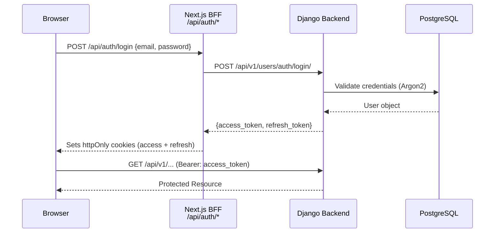

### 7.2 Pitch Deck Forensic Underwriting Flow

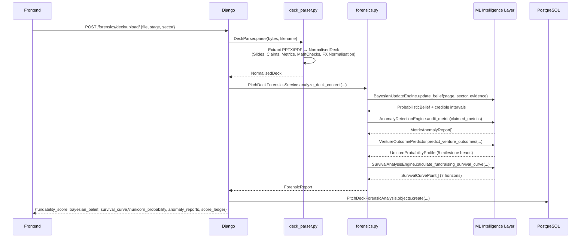

### 7.3 ML Prediction Flow

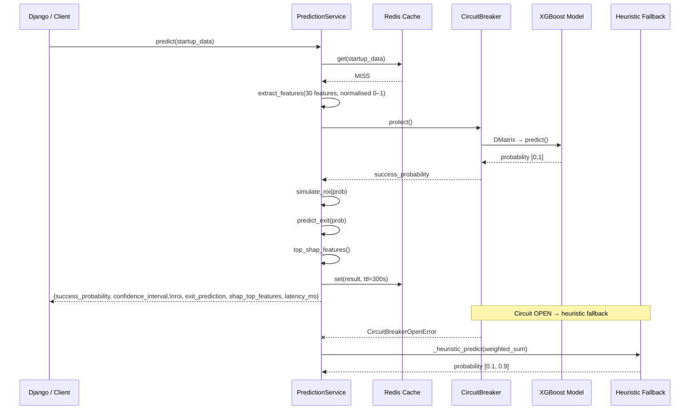

---

## 8. Real-Time & Async Infrastructure

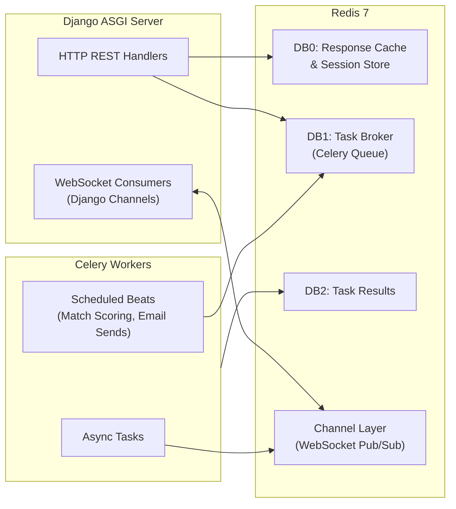

**Real-time use cases:**
- Live notification delivery to connected investors
- Real-time matching score updates after profile edits
- Voice screening session turn streaming
- Live pitch activity feed updates

---

## 9. AI/Intelligence Layer Architecture

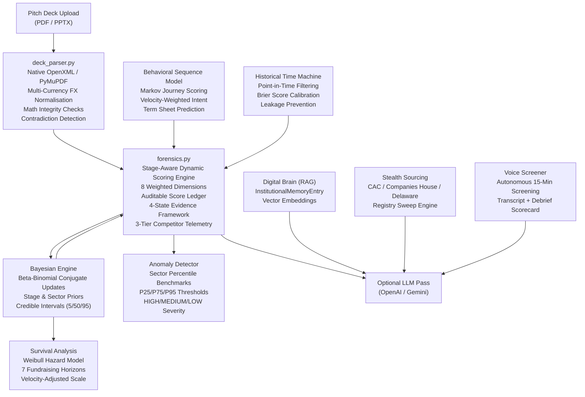

**Zero-Fake-AI Principle:** All scoring and mathematical verification is deterministic. LLM is used optionally for natural-language claim extraction only. Every final score is an exact, auditable calculation with a full evidence ledger.

---

## 10. Security Architecture

| Layer | Mechanism |
| :--- | :--- |
| **Auth** | JWT Access Tokens (15 min TTL) + httpOnly Refresh Cookies (7 day TTL) |
| **Password Hashing** | Argon2 (primary) → PBKDF2 → BCrypt (fallback chain) |
| **ML Auth** | HS256 JWT verified in ML service; `require_admin` RBAC for destructive ops |
| **Rate Limiting** | Sliding-window per-IP (atomic Redis Lua; thread-safe memory fallback; fail-open) |
| **Circuit Breaker** | CLOSED / OPEN / HALF_OPEN wraps every XGBoost inference call |
| **API Authorization** | `IsAuthenticated` default; `AllowAny` only on webhook & upload endpoints |
| **CORS** | Strict origin allowlist; `CORS_ALLOW_CREDENTIALS = True` |
| **Token Blacklist** | `simplejwt.token_blacklist` tracks invalidated refresh tokens |
| **Data Isolation** | All queries scoped to `request.user`; no cross-tenant leakage |
| **File Validation** | MIME type + extension check before deck parse |
| **B2B API Keys** | Bcrypt-hashed key storage; prefix-based fast lookup; provisioning audit logs |
| **ML API Key** | `X-ML-API-Key` header guard (configurable; disabled by default in dev) |

---

## 11. Deployment Topology

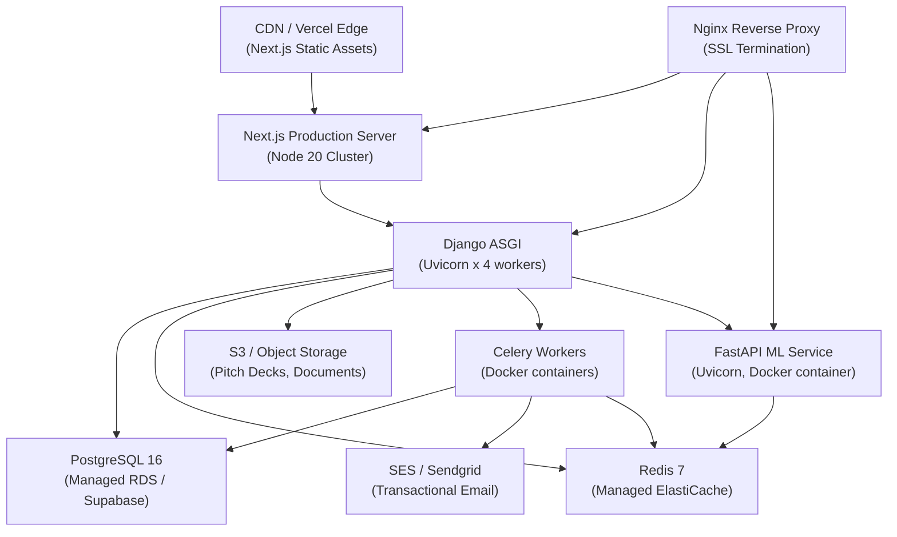

---

## 12. Platform Capabilities Summary

| Feature | Status | Key Technology |
| :--- | :--- | :--- |
| Startup & Investor profiles | Live | Django users app, Next.js profile pages |
| Pitch creation & management | Live | pitches app, S3 file storage |
| AI-powered investor matching | Live | matching app, MatchScore model |
| Investment offers & negotiation | Live | offers app, WebSocket bid consumer |
| NDA-gated secure data room | Live | dataroom app, signed NDA flow, slide logs |
| Activity newsfeed | Live | newsfeed app, real-time WebSocket |
| Smart outreach campaigns | Live | marketing app, Celery async sends |
| Fundraising analytics dashboard | Live | analytics app, prediction engine |
| Forensic pitch deck underwriting | Live | intelligence/forensics.py, deck_parser.py |
| **Bayesian belief updating** | Live | BayesianUpdateEngine — Beta-Binomial conjugate |
| **Anomaly detection** | Live | AnomalyDetectionEngine — sector percentile benchmarks |
| **Multi-task outcome prediction** | Live | VentureOutcomePredictor — 5 milestone heads |
| **Weibull survival analysis** | Live | SurvivalAnalysisEngine — 7 fundraising horizons |
| **Investor behavioral sequences** | Live | BehavioralSequenceModel — Markov intent scoring |
| **Historical time machine** | Live | HistoricalTimeMachine — Brier / leakage-free backtest |
| **XGBoost prediction service** | Live | ml/predictor.py — 30 features, circuit breaker, SHAP |
| **Sliding-window rate limiter** | Live | ml/security/rate_limiter.py — atomic Redis Lua |
| **JWT RBAC (ML service)** | Live | ml/security/auth.py — HS256, bcrypt, Depends chain |
| Institutional memory (RAG Brain) | Live | InstitutionalMemoryEntry + vector embeddings |
| Stealth founder radar | Live | StealthFounderSignal, registry sweep |
| Autonomous voice screening | Live | VoiceInterviewSession |
| B2B enterprise licensing & API | Live | EnterpriseTenant, TenantAPIKey metering |
| Real-time notifications | Live | Django Channels + Redis |
| Accelerator cohort management | Live | Cohort, CohortApplication, ICMemoVote |

---

## 13. Getting Started

### Prerequisites

- Python 3.11+, Node.js 20+, PostgreSQL 16+, Redis 7+

### Backend

```bash
cd backend
python -m venv venv && venv\Scripts\activate   # Windows
pip install -r requirements.txt
cp ../.env.example ../.env
python manage.py migrate
python manage.py runserver 0.0.0.0:8000
```

### Celery Worker

```bash
cd backend
celery -A config worker --loglevel=info
```

### ML Service

```bash
cd ml
pip install -r requirements.txt
uvicorn main:app --host 0.0.0.0 --port 8001 --reload
```

### Frontend

```bash
cd frontend
npm install
npm run dev
```

| Service | URL |
| :--- | :--- |
| Web App | `http://localhost:3000` |
| Django API | `http://localhost:8000` |
| ML Service | `http://localhost:8001` |
| API Docs (Django) | `http://localhost:8000/api/docs/` |
| API Docs (ML) | `http://localhost:8001/docs` |
| ML Metrics | `http://localhost:8001/metrics` |

---

## 14. Environment Variables

| Variable | Description | Default |
| :--- | :--- | :--- |
| `SECRET_KEY` | Django signing key | Required |
| `DATABASE_URL` | PostgreSQL connection string | `sqlite:///db.sqlite3` |
| `REDIS_URL` | Redis URL | `redis://127.0.0.1:6379/0` |
| `CELERY_BROKER_URL` | Celery broker | `redis://localhost:6379/1` |
| `OPENAI_API_KEY` | OpenAI key (optional) | `""` |
| `GOOGLE_GEMINI_API_KEY` | Gemini key (optional) | `""` |
| `NEXT_PUBLIC_API_URL` | Backend base URL | `http://localhost:8000` |
| `CORS_ALLOWED_ORIGINS` | Frontend origins | `http://localhost:3000` |
| `MODEL_PATH` | ML model artefacts directory | `/app/models` |
| `ML_API_KEY` | Static ML API key guard | `""` (disabled) |
| `JWT_SECRET_KEY` | HS256 secret for ML service | Required in prod |
| `CIRCUIT_BREAKER_THRESHOLD` | Failures before circuit opens | `5` |
| `CIRCUIT_BREAKER_TIMEOUT` | Seconds before half-open probe | `60` |
| `ENABLE_CACHE` | Toggle prediction caching | `true` |
| `CACHE_TTL_SECONDS` | Prediction cache TTL | `300` |
| `MAX_BATCH_SIZE` | Max items per batch prediction | `100` |
| `RATE_LIMIT_REQUESTS` | Requests per window | `100` |
| `RATE_LIMIT_PERIOD_SECONDS` | Window length in seconds | `60` |

---

## 15. Quality & Verification

```bash
# Backend tests
cd backend && pytest

# ML service tests
cd ml && pytest tests/

# Frontend TypeScript check
cd frontend && npx tsc --noEmit

# Frontend production build
cd frontend && npm run build
```

---

## License

Proprietary. All rights reserved.
