# Pitchmic — Full Architectural Design

> **Platform**: AI-Native Venture Capital Intelligence & Founder-Investor Networking
> **Stack**: Django 5 · Next.js 14 · FastAPI ML Service · PostgreSQL · Redis · ChromaDB · Caddy

---

## 1. System Overview

Pitchmic is a two-sided marketplace connecting **startup founders** with **institutional investors**. The ML engine — Bayesian inference, survival analysis, graph ML, anomaly detection, calibration, behavioral scoring — is **always active** and owns every probability or score. LLMs are auxiliary, used only for claim extraction and narrative explanation; they never own a forecast. `ENABLE_AI_FEATURES` defaults to **`False`** (pure-ML mode).

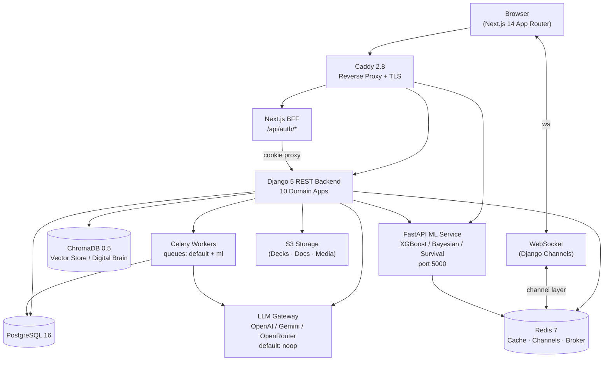

---

## 2. Backend Configuration

| Component | Technology | Notes |
| :--- | :--- | :--- |
| Reverse Proxy | **Caddy 2.8** | Automatic TLS (replaces Nginx) |
| Web Server | **Django 5 + Uvicorn ASGI** | HTTP REST + WebSocket |
| Task Queue | **Celery 5 + django-celery-beat** | Queues: `default`, `ml` |
| Scheduler | **DatabaseScheduler** | Beat schedules in PostgreSQL |
| Broker | **Redis 7** | DB0 Cache+Sessions · DB1 Broker · DB2 Results |
| Vector Store | **ChromaDB 0.5.23** | Digital Brain RAG; `CHROMA_AUTH_TOKEN` |
| Auth | **djangorestframework-simplejwt** | Access **30 min** · Refresh 7 day · Argon2 |
| CORS | **django-cors-headers** | `CORS_ALLOW_ALL_ORIGINS=True` in DEBUG only |
| API Schema | **drf-spectacular** | OpenAPI 3 · Swagger · ReDoc |
| LLM | **OpenAI / Gemini / OpenRouter / noop** | `ENABLE_AI_FEATURES=False` default |

### ML-First Capability Tiers

| Tier | Meaning |
| :--- | :--- |
| `ml_only` | Always on — deterministic, no LLM |
| `ai_opt` | LLM when available; heuristic fallback always present |
| `ai_req` | Disabled when `ENABLE_AI_FEATURES=False` |

Runtime matrix: `GET /api/v1/predictive/features/capabilities/`

---

## 3. Domain Application Map

```mermaid
flowchart LR
    subgraph BACKEND["Django Backend — apps/"]
        users["users\nCustom User · StartupProfile\nInvestorProfile · TeamMember"]
        pitches["pitches\nPitch · PitchAttachment · PitchLike"]
        matching["matching\nMatchScore · 5-dim cosine algorithm"]
        offers["offers\nOffer · WebSocket bid consumer"]
        dataroom["dataroom\nDocument · Folder · DocumentVersion\nAuditLog · 5-tier classification\nSlide heatmap telemetry"]
        newsfeed["newsfeed\nActivity feed"]
        notifications["notifications\nIn-App · Email"]
        marketing["marketing\nOutreachCampaign · OutreachMessage"]
        analytics["analytics\nFundraisingPrediction\nStartupScoringEngine 5-dim"]
        intelligence["intelligence\n11+ models · 4-stage DD pipeline\nHybridRAG · Digital Brain · Voice\nKnowledge Graph · RBAC\nMetering · Licensing · Cohorts"]
        predictive["predictive_intelligence\nFeature Store · Venture Outcomes\nSurvival · Bayesian Logs\nInvestor Intent · Graph ML\nAnomaly · Calibration · MLOps"]
    end
```

---

## 4. Intelligence App — Model Taxonomy

```mermaid
erDiagram
    PitchDeckForensicAnalysis {
        int id
        fk startup
        float fundability_score
        json unit_economics_audit
        json competitor_benchmarks
        json score_ledger
        json dimension_scores
        text bull_thesis
        text bear_thesis
    }
    DueDiligenceReport {
        int id
        fk startup
        string status
        string verdict
        json debate_transcript
        json scorecard
        text final_memo
    }
    StealthFounderSignal {
        int id
        string founder_name
        string signal_type
        float confidence
        string jurisdiction
    }
    InstitutionalMemoryEntry {
        int id
        string company_name
        string source_type
        text content
        vector embedding
        string verdict
    }
    VoiceInterviewSession {
        int id
        fk startup
        string stage
        string persona
        json transcript
        json debrief_scorecard
    }
    EnterpriseTenant {
        int id
        string name
        string tier
        int monthly_deal_quota
    }
    TenantAPIKey {
        int id
        fk tenant
        string key_prefix
        string key_hash_sha256
    }
    Cohort {
        int id
        string name
        string program_type
        date application_deadline
    }
    ICMemoVote {
        int id
        fk report
        fk voter
        string verdict
        text rationale
    }
```

---

## 5. Full API Endpoint Contract

### 5.1 Core Domain

| App | Route | Method | Purpose |
| :--- | :--- | :--- | :--- |
| **auth** | `/api/v1/users/auth/login/` | POST | JWT Login |
| | `/api/v1/users/auth/register/` | POST | Register |
| | `/api/v1/users/auth/refresh/` | POST | Rotate Token |
| | `/api/v1/users/auth/verify-email/` | POST | TimestampSigner (24 h) |
| | `/api/v1/users/auth/resend-verification/` | POST | Resend (202 anti-enum) |
| | `/api/v1/users/profile/me/` | GET/PATCH | Profile |
| | `/api/v1/me/startup-profile/` | GET/PATCH | Startup + inline logo |
| | `/api/v1/me/investor-profile/` | GET/PATCH | Investor profile |
| | `/api/v1/upload/avatar/` | POST | Avatar (5 MB JPEG/PNG/WebP/GIF) |
| | `/api/v1/upload/logo/` | POST | Startup logo |
| | `/api/v1/upload/pitch-cover/` | POST | Pitch cover image |
| | `/api/v1/admin/summary/` | GET | Live DB telemetry (staff only) |
| **pitches** | `/api/v1/pitches/` | GET/POST | List & Create |
| | `/api/v1/pitches/<id>/` | GET/PUT/DELETE | CRUD |
| **matching** | `/api/v1/matching/top/` | GET | Top Matches |
| | `/api/v1/matching/refresh/` | POST | Recalculate |
| **offers** | `/api/v1/offers/` | GET/POST | Offers |
| **dataroom** | `/api/v1/dataroom/` | GET/POST | Document Upload |
| | `/api/v1/dataroom/<id>/grant/` | POST | NDA + Access |
| | `/api/v1/dataroom/access/<pk>/` | PATCH | Update permissions |
| | `/api/v1/dataroom/my-access/` | GET | Investor's grants |
| | `/api/v1/dataroom/telemetry/` | POST | Slide engagement |
| | `/api/v1/dataroom/telemetry/<doc_id>/` | GET | Heatmap + drop-off |
| **analytics** | `/api/v1/analytics/predict/` | POST | Fundraising Score |
| | `/api/v1/analytics/behavior/` | POST | Heatmap Telemetry |

### 5.2 Intelligence Endpoints (30 routes)

| Route | Method | Purpose |
| :--- | :--- | :--- |
| `/api/v1/intelligence/forensics/deck/upload/` | POST | Stage-aware deck underwriting |
| `/api/v1/intelligence/forensics/deck/` | POST | Text-based forensic analysis |
| `/api/v1/intelligence/startup/<pk>/` | GET | Startup intelligence |
| `/api/v1/intelligence/due-diligence/` | POST | Kick off 4-stage DD pipeline |
| `/api/v1/intelligence/due-diligence/<id>/` | GET | Retrieve DD report |
| `/api/v1/intelligence/due-diligence/<id>/debate/` | POST | Bull vs Bear debate |
| `/api/v1/intelligence/due-diligence/<id>/export/` | GET | LP-ready IC memo export |
| `/api/v1/intelligence/due-diligence/<id>/vote/` | POST | Partner consensus voting |
| `/api/v1/intelligence/predict/outcomes/` | POST | Multi-task unicorn probability |
| `/api/v1/intelligence/evidence/audit/` | POST | Immutable score ledger |
| `/api/v1/intelligence/graph/query/` | POST | Knowledge graph traversal |
| `/api/v1/intelligence/brain/query/` | POST | RAG Digital Brain query |
| `/api/v1/intelligence/brain/ingest/` | POST | Ingest memo/thesis |
| `/api/v1/intelligence/stealth/signals/` | GET | Browse stealth signals |
| `/api/v1/intelligence/stealth/discover/` | POST | Multi-registry sweep |
| `/api/v1/intelligence/voice/start/` | POST | Start voice session |
| `/api/v1/intelligence/voice/<id>/turn/` | POST | Submit transcript turn |
| `/api/v1/intelligence/voice/<id>/debrief/` | POST | Partner debrief scorecard |
| `/api/v1/intelligence/tenants/` | GET/POST | Enterprise tenants |
| `/api/v1/intelligence/tenants/<id>/keys/` | POST | Provision B2B API key |
| `/api/v1/intelligence/external/triage/` | POST | Partner triage + async webhook |
| `/api/v1/intelligence/antler/webhook/` | POST | Antler Hub sync |
| `/api/v1/intelligence/cohorts/` | GET/POST | Accelerator cohorts |
| `/api/v1/intelligence/cohorts/batch-upload/` | POST | Bulk upload (8-pillar scoring) |
| `/api/v1/intelligence/cohorts/<id>/leaderboard/` | GET | Ranked applications |
| `/api/v1/intelligence/cohorts/<id>/apply/` | POST | Startup applies |
| `/api/v1/intelligence/funding-events/` | GET/POST | Demo days · pitch nights |
| `/api/v1/intelligence/feedback/` | POST | Prediction feedback |
| `/api/v1/intelligence/models/` | GET | Model performance (staff) |

### 5.3 Predictive Intelligence Endpoints (25 routes)

| Route | Method | Purpose |
| :--- | :--- | :--- |
| `/api/v1/predictive/features/<id>/list/` | GET | Feature snapshots |
| `/api/v1/predictive/features/<id>/capture/` | POST | Capture snapshot |
| `/api/v1/predictive/features/snapshot/<pk>/` | GET | Snapshot detail |
| `/api/v1/predictive/features/capabilities/` | GET | ML vs AI matrix |
| `/api/v1/predictive/outcomes/startup/<pk>/latest/` | GET | Latest prediction |
| `/api/v1/predictive/outcomes/startup/<pk>/generate/` | POST | Generate prediction |
| `/api/v1/predictive/outcomes/<pk>/` | GET | Detail + survival + Bayesian |
| `/api/v1/predictive/outcomes/<pk>/feedback/` | POST | V2 feedback |
| `/api/v1/predictive/time-machine/<id>/list/` | GET | Historical snapshots |
| `/api/v1/predictive/time-machine/<id>/build/` | POST | Build historical snapshot |
| `/api/v1/predictive/time-machine/evaluate/` | POST | Backtest evaluation |
| `/api/v1/predictive/intent/startup/<id>/` | GET | Top investors by P(invest) |
| `/api/v1/predictive/intent/investor/<id>/score/` | POST | Score investor sequence |
| `/api/v1/predictive/graph/entities/` | GET/POST | Graph entity CRUD |
| `/api/v1/predictive/graph/entity/` | POST | Create entity |
| `/api/v1/predictive/graph/relation/` | POST | Create relation |
| `/api/v1/predictive/graph/traverse/` | POST | Multi-mode traversal |
| `/api/v1/predictive/anomalies/` | GET | Unresolved anomalies |
| `/api/v1/predictive/anomalies/audit/` | POST | Audit metrics batch |
| `/api/v1/predictive/anomalies/<pk>/resolve/` | POST | Analyst resolve |
| `/api/v1/predictive/registry/` | GET/POST | Model family registry |
| `/api/v1/predictive/registry/<pk>/versions/` | GET | Model versions |
| `/api/v1/predictive/evaluations/` | GET | Backtest runs |
| `/api/v1/predictive/experiments/` | GET | A/B experiments |
| `/api/v1/predictive/calibration/<version_id>/` | GET | Calibration records |

---

## 6. Frontend — Next.js 14 App Router

### 6.1 Route Structure

```
src/app/
├── layout.tsx · page.tsx · not-found.tsx · providers.tsx
├── (auth)/                    MarketingShell
│   ├── sign-in/
│   ├── sign-up/[role]/
│   └── verify/[token]/
├── (dashboard)/               Protected — Sidebar + Navbar
│   ├── layout.tsx
│   ├── newsfeed/  discover/   pitches/  pitches/new/
│   ├── pitches/[id]/  pitches/[id]/edit/   offers/
│   ├── messages/  dataroom/   campaigns/   notifications/
│   ├── analytics/ intelligence/ fundability/ accelerator/
│   ├── admin/     settings/   upgrade/     company/
│   └── profile/edit · avatar · logo
└── api/auth/  login · logout · refresh · register · verify · me
```

### 6.2 Key Modules

| Module | Purpose |
| :--- | :--- |
| `src/lib/api.ts` | Axios client — attaches JWT, handles 401 refresh |
| `src/lib/intelligenceApi.ts` | Typed intelligence + predictive endpoints |
| `src/lib/validators.ts` | Zod schemas (SignIn, SignUp, Pitch) |
| `src/lib/types.ts` | Shared TypeScript types |
| `src/hooks/useAuth.tsx` | Auth context: login, logout, refresh |
| `src/hooks/useNewsfeed.ts` | Paginated feed + infinite scroll |
| `src/hooks/useNotifications.ts` | Real-time notification subscription |
| `src/hooks/useInfiniteScroll.ts` | IntersectionObserver hook |

### 6.3 Component Library

```
ui/       Button · Card · Badge · Input · Label · Separator
          Sheet · DropdownMenu · Logo · Avatar · Textarea · Tooltip
layout/   Sidebar · Navbar · DashboardShell · MarketingShell · Footer
analytics/ SuccessPredictorDashboard · InvestorROIDashboard · InvestmentHeatmap
pitches/  LikeButton
newsfeed/ PitchCard
offers/   OfferRow · BidPanel
```

---

## 7. ML Service — Standalone FastAPI Microservice

Runs as a **separate Docker container** on **port 5000** (`ml-service:5000`).

```
ml/
├── main.py                   FastAPI entry-point
├── predictor.py              Core 30-feature orchestrator
├── api/app.py                App factory (rate limiter + metrics middleware)
├── config/settings.py        Pydantic-settings (env-var driven)
├── models/registry.py        Versioned model registry (atomic JSON)
├── models/trainer.py         XGBoost training pipeline
├── cache/redis_cache.py      Two-tier: Redis 300s TTL + in-process LRU 60s TTL
├── monitoring/metrics.py     Prometheus metric catalog
├── monitoring/drift.py       PSI feature drift detection
├── security/auth.py          JWT HS256 + bcrypt RBAC
└── security/rate_limiter.py  Sliding-window — atomic Redis Lua
```

### 7.1 30-Feature Schema

| Category | Features |
| :--- | :--- |
| Team | `team_size`, `founder_experience_yrs`, `previous_exits`, `has_linkedin`, `has_github` |
| IP & Press | `patent_count`, `press_count`, `awards_count` |
| Financials | `current_revenue`, `revenue_growth_rate`, `gross_margin`, `runway_months`, `ltv_cac_ratio` |
| Traction | `customer_count`, `mau` |
| Market | `tam`, `sam`, `market_growth_rate` |
| Stage | `stage_seed`, `stage_series_a`, `stage_series_b_plus` |
| Company | `founded_years_ago` |
| Pitch Quality | `pitch_count`, `total_likes`, `total_offers`, `has_problem_section`, `has_solution_section`, `has_traction_section`, `has_financials_section`, `has_video` |

All features normalised to `[0, 1]` with per-feature caps.

### 7.2 Circuit Breaker

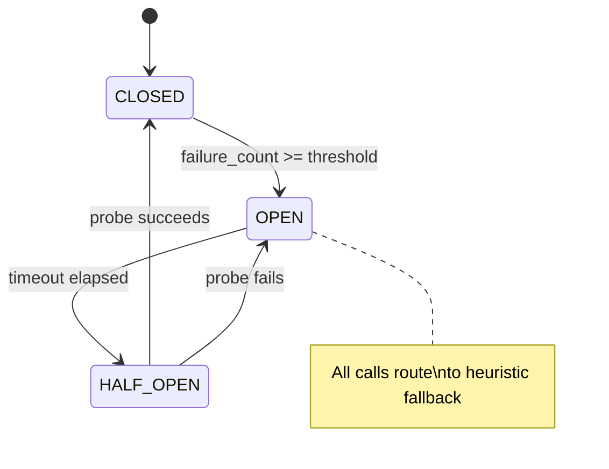

Config: `CIRCUIT_BREAKER_THRESHOLD=5`, `CIRCUIT_BREAKER_TIMEOUT=60s`

### 7.3 PSI Drift Detection

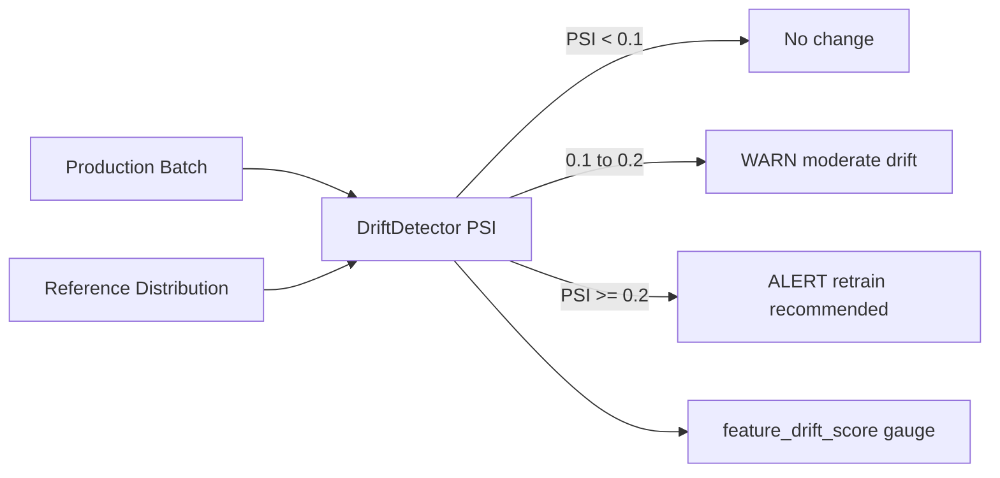

`MIN_SAMPLES=50`. Percentile-binned histogram via `np.histogram`. Reference updated via `DriftDetector.update_reference()` post-retraining.

### 7.4 Prometheus Metric Catalog

| Metric | Type | Labels |
| :--- | :--- | :--- |
| `predictions_total` | Counter | model, source, environment |
| `prediction_errors_total` | Counter | error_type, environment |
| `prediction_latency_seconds` | Histogram | model, environment |
| `batch_size_histogram` | Histogram | — |
| `model_accuracy` | Gauge | model_version |
| `feature_drift_score` | Gauge | feature_name |
| `cache_hits_total` | Counter | environment |
| `cache_misses_total` | Counter | environment |
| `circuit_breaker_open` | Gauge | name |
| `http_requests_total` | Counter | method, endpoint, status_code |
| `http_request_duration_seconds` | Histogram | method, endpoint |

### 7.5 ML API Endpoints

| Route | Method | Purpose |
| :--- | :--- | :--- |
| `/health` | GET | Liveness + model status |
| `/ready` | GET | Kubernetes readiness probe |
| `/metrics` | GET | Prometheus text exposition |
| `/predict/success` | POST | Single startup prediction |
| `/predict/batch` | POST | Parallel batch up to 100 |
| `/predict/embedding` | POST | Sentence-transformer embedding |
| `/model/info` | GET | Feature schema + version + registry |
| `/model/reload` | POST | Hot-reload without restart |
| `/api/v1/models/activate` | POST | Activate registry version (admin) |
| `/api/v1/models/{version}` | DELETE | Remove version (admin) |

---

## 8. ML Algorithms — Intelligence Sub-Package

`backend/apps/intelligence/ml/` — five deterministic engines, fully auditable.

### 8.1 Bayesian Update Engine

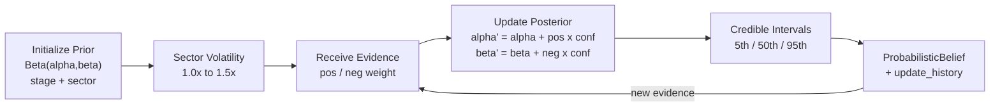

**Stage Priors**:

| Stage | α | β | Baseline P |
| :--- | :--- | :--- | :--- |
| Pre-seed | 2.0 | 18.0 | ~10% |
| Seed | 3.0 | 12.0 | ~20% |
| Series A | 5.0 | 10.0 | ~33% |
| Series B | 6.0 | 6.0 | ~50% |

**Sector Volatility Multipliers**:

| Sector | Multiplier |
| :--- | :--- |
| consumer | 1.5× |
| climate_hardware | 1.4× |
| ai_infrastructure | 1.3× |
| healthtech | 1.2× |
| fintech | 1.1× |
| enterprise_saas | 1.0× |

Outputs: `posterior_probability`, `credible_interval_5/50/95`, `uncertainty_score`, `update_history`.

### 8.2 Anomaly Detection Engine

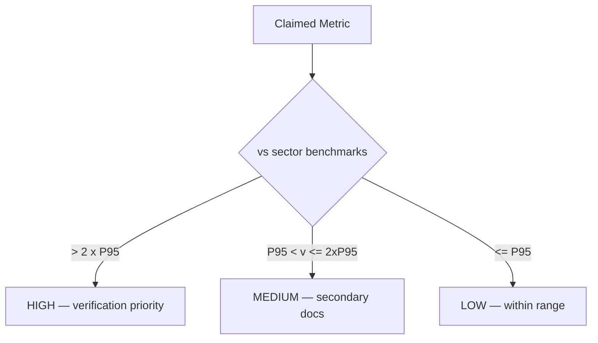

`enterprise_saas` benchmarks: MoM growth % (P95=50), gross margin % (P95=92), NRR % (P95=150), CAC payback months (P95=24).

### 8.3 Venture Outcome Predictor

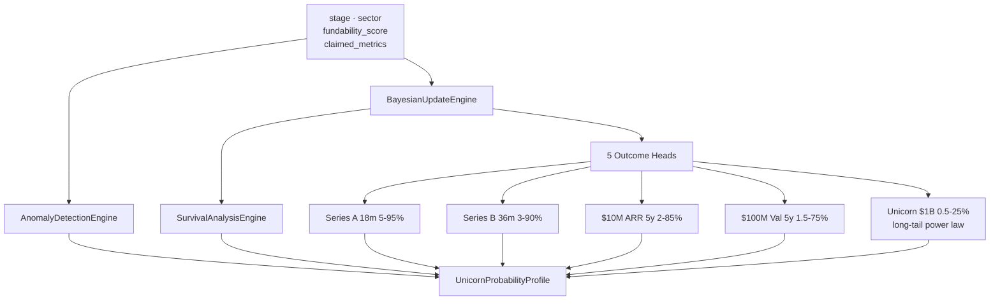

Confidence tiers: `VERY_HIGH` (evidence >= 85%, uncertainty < 1.0) → `HIGH` → `MODERATE` → `SPECULATIVE`

### 8.4 Weibull Survival Analysis

```
F(t) = 1 - exp( -(t / lambda)^k )

lambda  adjusted by traction velocity
k = 1.35  when runway < 12 months
k = 1.15  otherwise
h(t) = (k/lambda) x (t/lambda)^(k-1)
```

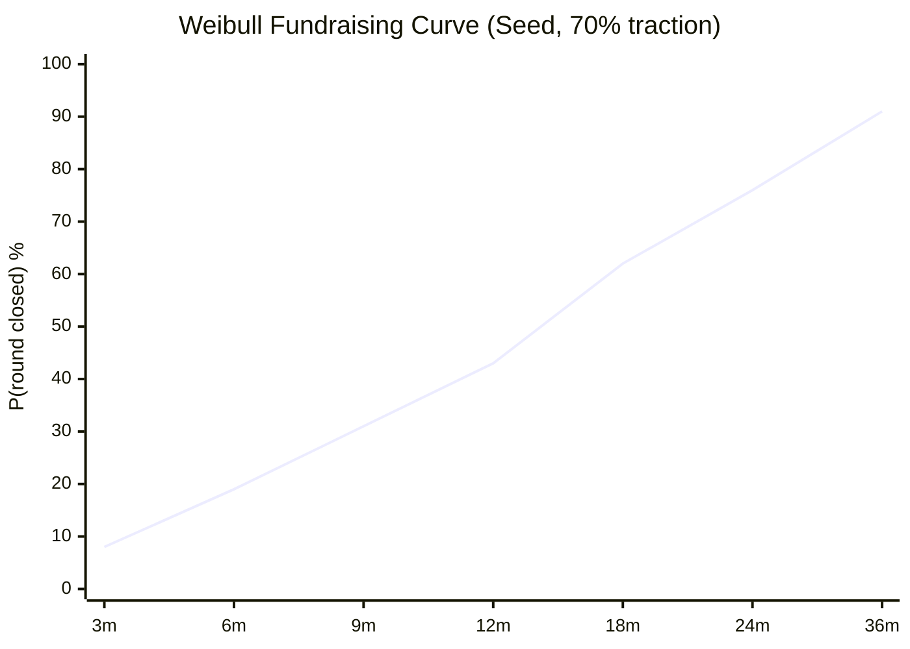

### 8.5 Behavioral Sequence Model (Markov)

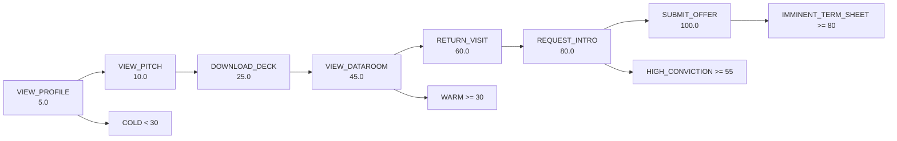

Velocity factor: events within 7 days earn up to **1.3× conviction multiplier**.

| Score | Tier | Next Action |
| :--- | :--- | :--- |
| >= 80 | IMMINENT_TERM_SHEET | Prepare IC memo + cap table |
| >= 55 | HIGH_CONVICTION | Partner deep-dive call |
| >= 30 | WARM | Updated traction + references |
| < 30 | COLD | Monitor signals |

### 8.6 Historical Time Machine

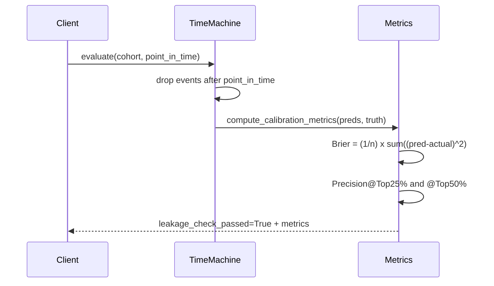

---

## 9. Intelligence Sub-Services

### 9.1 Four-Stage DD Pipeline

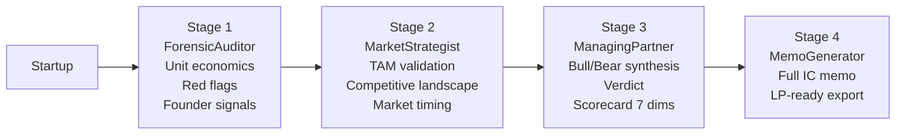

**Scorecard dimensions**: `innovators`, `market`, `product`, `financials`, `timing`, `competitive_moat`, `execution`

**Verdict values**: `invest` / `pass` / `monitor` / `needs_info`

Each stage falls back to deterministic heuristic when `ENABLE_AI_FEATURES=False`.

### 9.2 Hybrid RAG Engine

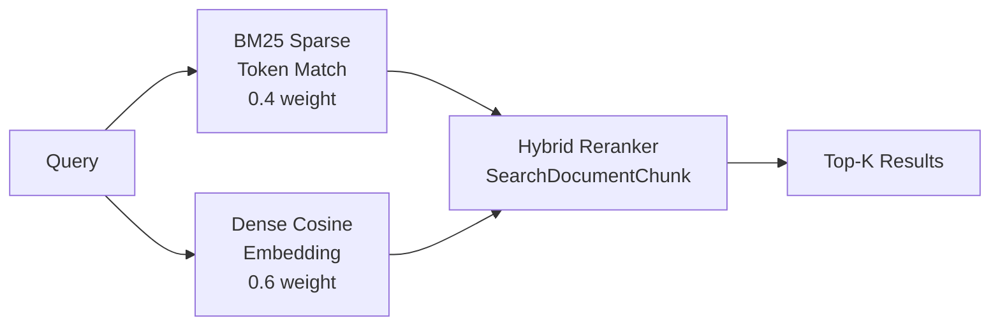

ChromaDB is the vector store. Token-overlap fallback when ChromaDB unavailable.

### 9.3 Forensic Underwriting — 8 Dimensions

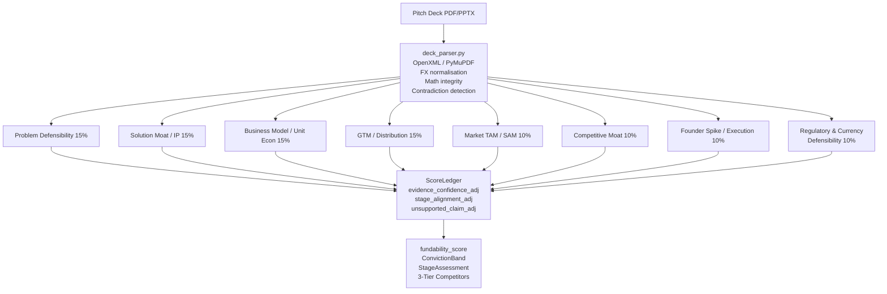

**SMI (Startup Maturity Index)**: starts 15, +20 MVP, +25 paying customers, +15 retention.
**Competitor tiers**: Tier 1 incumbents / Tier 2 direct / Tier 3 adjacent.

### 9.4 Digital Brain

Three operations on `InstitutionalMemoryEntry` backed by ChromaDB:

| Operation | Method | Notes |
| :--- | :--- | :--- |
| Ingest | `ingest_source()` | SHA-256 dedup; source types: ic_memo, partner_note, pitch_deck, post_mortem, thesis |
| Query | `query_memory()` | Token-overlap fallback when ChromaDB unavailable |
| Lint | `lint_memory()` | Contradiction detection + orphan entry detection |

### 9.5 Stealth Founder Collectors

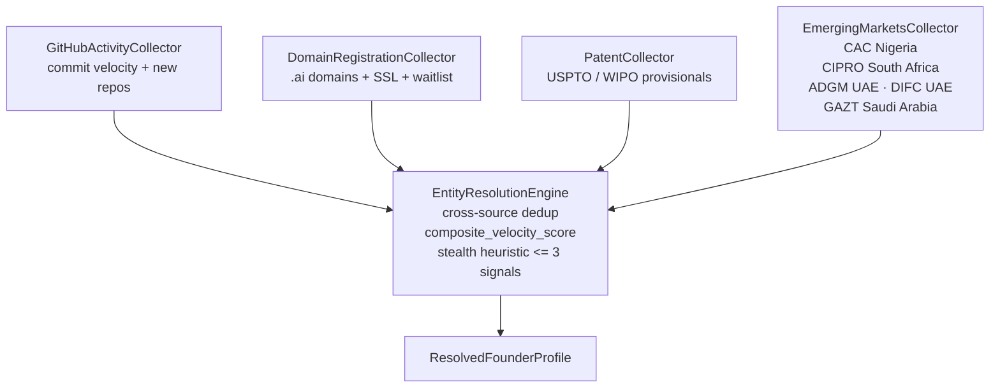

### 9.6 Voice Interview Scoring

**Stage questions**: pre_seed (4 Qs: Founder Spike, Customer Discovery), seed (3 Qs: Unit Economics, NRR), series_a (2 Qs: Expansion, Moat).

```
composite = 0.30 x communication_clarity
          + 0.40 x domain_depth
          + 0.30 x founder_conviction
```

**Tiers**: >= 75 → Fast-Track Partner Interview · >= 50 → Standard Diligence Review · < 50 → Pass/Keep on Radar

### 9.7 Investment Knowledge Graph

**Node types** (6): FOUNDER, STARTUP, INVESTOR, FUND, MARKET, COMPETITOR
**Edge types** (4): FOUNDED, INVESTED_IN, OPERATES_IN, COMPETES_WITH

Traversals: `find_co_investors(investor_id)`, `find_competitor_cluster(startup_id)`

### 9.8 Financial Usage Metering

| Action | Unit Cost |
| :--- | :--- |
| Voice session start | 15 |
| Deck upload / underwriting | 10 |
| Stealth discovery sweep | 8 |
| Predict outcomes | 5 |
| Digital Brain query | 2 |

### 9.9 B2B Licensing Tiers

| Tier | Monthly Quota | Key Format |
| :--- | :--- | :--- |
| STARTER | 50 units | `pm_live_` + 48-char hex (SHA-256 stored) |
| PRO | 200 units | `pm_live_` + 48-char hex |
| ENTERPRISE | Unlimited | `pm_live_` + 48-char hex |

### 9.10 RBAC Security Policy

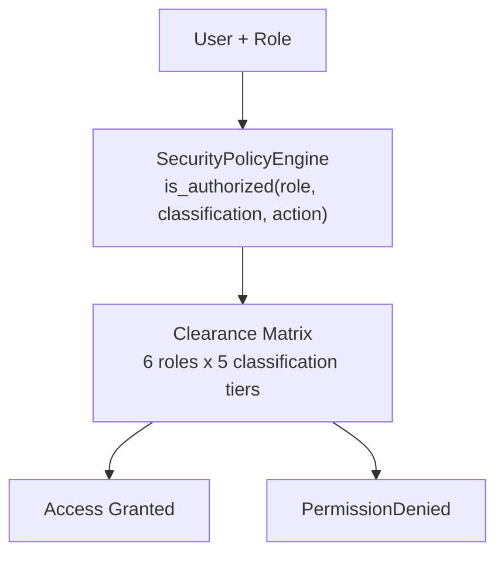

**Roles**: FOUNDER · INVESTOR · VENTURE_PARTNER · ANALYST · TENANT_ADMIN · SUPERADMIN
**Tiers**: PUBLIC → INTERNAL → CONFIDENTIAL → RESTRICTED → HIGHLY_RESTRICTED
Only VENTURE_PARTNER, TENANT_ADMIN, SUPERADMIN may access HIGHLY_RESTRICTED.

### 9.11 Domain Event Bus

In-process pub/sub decoupling pipeline stages:

```python
DomainEventBus.subscribe("PitchCreated", handler)
DomainEventBus.publish(DomainEvent(event_type="DeckUploaded", aggregate_id=pk, payload={}))
```

Fields: `event_id`, `event_type`, `aggregate_type`, `aggregate_id`, `payload`

---

## 10. Predictive Intelligence ORM — 11 Model Sections

```mermaid
flowchart TD
    subgraph PRED["predictive_intelligence models"]
        FS["FEATURE STORE\nStartupFeatureSnapshot\n22 feature fields\nsnapshot_hash SHA-256\npoint-in-time provenance"]
        KG["KNOWLEDGE GRAPH\nGraphEntity 12 types\nGraphRelation 18 types\nGNN embedding vectors"]
        TML["TEMPORAL ML\nVentureSurvivalForecast\nWeibull / Cox PH\nLog-Normal / Kaplan-Meier\ncdf_curve_json with CI bounds"]
        TAB["TABULAR ML\nVentureOutcomePrediction\n20+ probability fields\n7 outcome heads x multiple horizons\nRevenue forecast 12/24/36m\nValuation forecast 24/60/84m"]
        BAY["BAYESIAN\nBayesianUpdateLog\nprior/posterior alpha/beta per step\nevidence type + CI percentiles"]
        UNC["UNCERTAINTY\nUncertaintyDecomposition\n5 sources: data_sparsity\nevidence_conflict / epistemic\naleatoric / calibration"]
        CAL["CALIBRATION\nCalibrationRecord\nPlatt / isotonic / beta\ntemperature scaling + ECE"]
        REG["MLOPS REGISTRY\nModelRegistry · ModelVersion\nTrainingRun · EvaluationRun\nPredictionRun · Experiment\nAICapability · AIProviderUsageLog"]
        INV["INVESTOR ML\nInvestorIntentPrediction\n5 prob heads P(interest/intro/DD/offer/invest)\nInvestorBehavioralSequence\n12 event types · 5 horizons"]
        ANO["ANOMALY\nAnomalyDetectionRecord\n5 methods: IsolationForest\nLOF · robust z-score\npercentile benchmark · autoencoder\nanalyst resolution workflow"]
        HIST["HISTORICAL SNAPSHOTS\nStartupHistoricalSnapshot\n6 ground-truth milestones\nactual valuation at exit\nzero look-ahead enforced"]
    end
```

**Reproducibility chain**: `PredictionRun → ModelVersion → FeatureSetVersion → EvidenceSnapshot`

---

## 11. Analytics — Startup Scoring Engine

Deterministic heuristic, no ML dependency.

**5-Dimension Weights**:

| Dimension | Weight |
| :--- | :--- |
| Team | 0.35 |
| Market | 0.25 |
| Traction | 0.20 |
| Financials | 0.15 |
| Product | 0.05 |

**Extended outputs**: exit prediction, ROI projection (3/5/10 yr, best/worst/median), market potential score, growth phase (hypergrowth/fast_growth/growth/early_stage + hockey_stick_year), risk profile (5-dim breakdown + mitigations), peer benchmarks, confidence interval from 10-field `_data_completeness()`.

---

## 12. Matching Algorithm

5-dimension cosine compatibility:

| Dimension | Weight | Method |
| :--- | :--- | :--- |
| Industry | 0.30 | Jaccard-like overlap ratio |
| Stage | 0.25 | Exact match |
| Ticket size | 0.25 | Inversely proportional to range distance |
| Location | 0.10 | Geographic containment |
| Semantic | 0.10 | Cosine on `embedding_vector` (0.5 neutral fallback) |

---

## 13. Secure Data Room

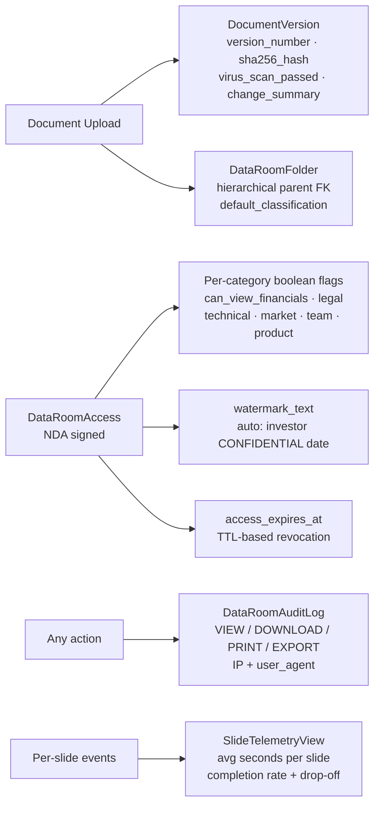

**5 Classification Tiers**: PUBLIC → INTERNAL → CONFIDENTIAL → RESTRICTED → HIGHLY_RESTRICTED

---

## 14. Data Flows

### 14.1 Authentication

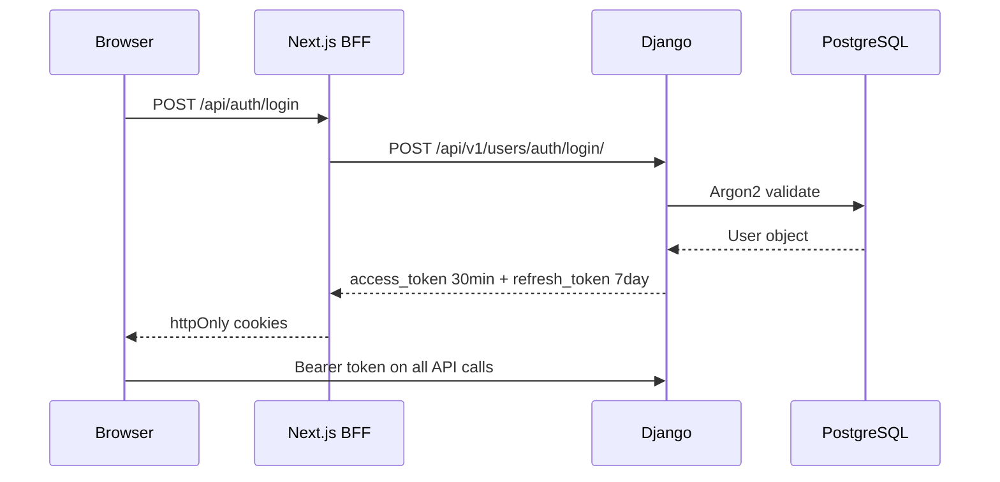

### 14.2 Forensic Deck Underwriting

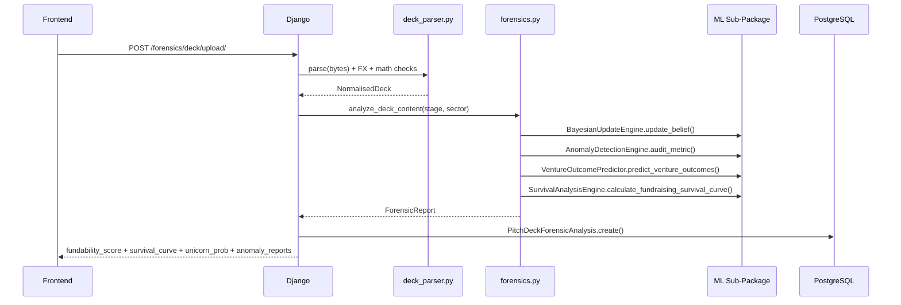

### 14.3 ML Prediction

```mermaid
sequenceDiagram
    participant DJ as Django
    participant PS as PredictionService
    participant CA as Cache
    participant CB as CircuitBreaker
    participant XGB as XGBoost
    participant HF as Heuristic
    DJ->>PS: predict(startup_data)
    PS->>CA: get() MISS
    PS->>PS: extract_features (30 features normalised 0-1)
    PS->>CB: protect()
    CB->>XGB: DMatrix predict()
    XGB-->>PS: probability
    PS->>PS: simulate_roi(prob)
    PS->>PS: predict_exit(prob)
    PS->>PS: top_shap_features()
    PS->>CA: set(ttl=300s)
    PS-->>DJ: success_probability + roi + exit + shap
    note over CB,HF: OPEN -> heuristic
    CB--xPS: CircuitBreakerOpenError
    PS->>HF: weighted_sum -> 0.1 to 0.9
```

### 14.4 Venture Outcome Generation

```mermaid
sequenceDiagram
    participant C as Client
    participant V as VentureOutcomeGenerateView
    participant OP as VentureOutcomePredictor
    participant PG as PostgreSQL
    C->>V: POST /api/v1/predictive/outcomes/startup/{pk}/generate/
    V->>OP: predict_venture_outcomes(stage, sector, metrics)
    OP->>OP: Bayesian update
    OP->>OP: Anomaly audit
    OP->>OP: Survival curve 7 horizons
    OP->>OP: 5 milestone probability heads
    OP-->>V: UnicornProbabilityProfile
    V->>PG: VentureOutcomePrediction.create()
    V->>PG: VentureSurvivalForecast.create() x milestones
    V->>PG: BayesianUpdateLog.create() per step
    V->>PG: UncertaintyDecomposition.create()
    V-->>C: full serialized prediction
```

---

## 15. Real-Time & Async Infrastructure

```mermaid
flowchart LR
    subgraph Django["Django ASGI"]
        HTTP["HTTP REST"]
        WS["WebSocket Consumers"]
    end
    subgraph Celery["Celery Workers"]
        ML_Q["ml queue\nmatching · analytics · intelligence"]
        DEF_Q["default queue\nmarketing · notifications"]
        BEAT["Celery Beat\nDatabaseScheduler"]
    end
    subgraph Redis["Redis 7"]
        R0["DB0 Cache + Sessions"]
        R1["DB1 Broker"]
        R2["DB2 Results"]
        CH["Channel Layer"]
    end
    HTTP --> R0
    WS <--> CH
    HTTP --> R1
    Celery --> R2
    BEAT --> R1
```

**Celery Beat Schedule**:

| Task | Schedule | Queue |
| :--- | :--- | :--- |
| `matching.update_all_match_scores` | Nightly 2 AM UTC | ml |
| `analytics.update_all_predictions` | Nightly 3 AM UTC | ml |
| `analytics.update_investor_behavior_all` | Weekly Sunday 4 AM UTC | default |
| `marketing.send_all_active_campaigns` | Daily 9 AM UTC | default |

---

## 16. Full Intelligence Architecture

```mermaid
flowchart TD
    Deck["Pitch Deck\nPDF / PPTX"] --> DP["deck_parser.py\nOpenXML · PyMuPDF\nFX Normalisation\nMath Checks · Contradictions"]
    DP --> FS["forensics.py\n8-Dim Scoring Engine\nSMI · ScoreLedger\n3-Tier Competitors"]
    FS --> BAY["Bayesian Engine\nBeta-Binomial\nStage+Sector Priors\nCredible Intervals"]
    FS --> ANO["Anomaly Detector\nPercentile Benchmarks\nP95 Thresholds"]
    BAY --> SURV["Weibull Survival\n7 Horizons\nVelocity-Adjusted"]
    BAY --> OUT["Venture Outcome\n5 Milestone Heads"]
    SEQ["Behavioral Sequences\nMarkov Journey\nVelocity-Weighted"] --> FS
    TM["Time Machine\nPoint-in-Time Filter\nBrier Calibration"] --> FS
    GRAPH["Knowledge Graph\nCo-investor Cluster\nCompetitor Traversal"] --> FS
    BRAIN["Digital Brain\nHybrid RAG BM25+Dense\nChromaDB vector store"] --> LLM
    STEALTH["Stealth Collectors\nGitHub · Domain · Patent\nCAC · CIPRO · ADGM\nDIFC · GAZT"] --> LLM
    VOICE["Voice Screener\n3-Metric Rubric\nStage Questions"] --> LLM
    FS --> LLM["LLM Optional\nOpenAI / Gemini\nOpenRouter / noop"]
```

---

## 17. Security Architecture

| Layer | Mechanism |
| :--- | :--- |
| Reverse Proxy | Caddy 2.8 — automatic TLS |
| Auth | JWT Access **30 min** + httpOnly Refresh 7 day |
| Password Hashing | Argon2 → PBKDF2 → BCrypt fallback |
| ML Auth | HS256 JWT + `require_admin` RBAC (bcrypt passwords) |
| Rate Limiting | Sliding-window atomic Redis Lua; memory fallback; fail-open |
| Circuit Breaker | CLOSED / OPEN / HALF_OPEN — XGBoost inference |
| RBAC | SecurityPolicyEngine — 6 roles × 5 classification tiers |
| Token Blacklist | simplejwt.token_blacklist + `ROTATE_REFRESH_TOKENS=True` |
| Data Isolation | All queries scoped to `request.user` |
| Data Room | SHA-256 doc hashing, virus scan flag, per-action audit log |
| B2B API Keys | SHA-256 hash; `pm_live_` prefix; provisioning audit |
| ChromaDB | Token-auth via `CHROMA_AUTH_TOKEN` |
| CORS | Strict allowlist; `CORS_ALLOW_ALL_ORIGINS=True` in DEBUG only |
| Domain Events | `DomainEventBus` — in-process fan-out, no external exposure |

### ML Security

```mermaid
flowchart LR
    subgraph RL["Rate Limiter"]
        REQ["Request client_id + weight"] --> RD{Redis?}
        RD -->|Yes| LUA["Atomic Lua\nZREMRANGEBYSCORE\nZCARD · ZADD · EXPIRE"]
        RD -->|No| MEM["threading.Lock\ndefaultdict\neviction 120s"]
        LUA -->|1| OK["200 Allow\nX-RateLimit-Remaining"]
        LUA -->|0| BLOCK["429 Retry-After"]
    end
    subgraph RBAC["JWT Auth"]
        T["Bearer token"] --> GCU["get_current_user\nHS256 decode"]
        GCU -->|valid| RA["require_auth"]
        RA -->|admin| RADM["require_admin"]
        GCU -->|invalid| E401["401"]
        RADM -->|denied| E403["403"]
    end
```

---

## 18. Deployment Topology

```mermaid
flowchart TD
    CDN["CDN / Vercel Edge\nNext.js static assets"]
    Caddy["Caddy 2.8\nAutomatic TLS"]
    Next["Next.js Node 20 Cluster"]
    DJ["Django ASGI\nUvicorn x4 workers"]
    ML["FastAPI ML Service\nUvicorn · Docker · port 5000"]
    PG["PostgreSQL 16\nRDS / Supabase"]
    Redis["Redis 7\nElastiCache"]
    Chroma["ChromaDB 0.5\nDocker volume chroma_data"]
    Celery["Celery Workers\nqueues: default + ml"]
    Beat["Celery Beat\nDatabaseScheduler"]
    S3["S3 / Object Storage"]
    Email["SES / Sendgrid"]
    MLVol["ml_models volume"]

    CDN --> Next
    Caddy --> Next & DJ & ML
    Next --> DJ
    DJ --> PG & Redis & Chroma & S3 & Celery & ML
    ML --> Redis & MLVol
    Celery --> PG & Email & Redis
    Beat --> Redis
```

**Docker volumes**: `postgres_data` · `redis_data` · `chroma_data` · `ml_models` · `backend_static` · `backend_media` · `caddy_data` · `caddy_config`

---

## 19. Platform Capabilities Summary

| Feature | Status | Technology |
| :--- | :--- | :--- |
| Startup & Investor profiles | Live | users app |
| Pitch creation & management | Live | pitches app, S3 |
| 5-dim cosine investor matching | Live | matching/services.py |
| Investment offers + WebSocket bids | Live | offers app |
| NDA-gated data room (5-tier classification) | Live | dataroom app |
| Folder hierarchy + document versioning | Live | DataRoomFolder, DocumentVersion |
| Per-action audit log + slide heatmap | Live | DataRoomAuditLog, SlideTelemetryView |
| Activity newsfeed | Live | newsfeed + WebSocket |
| Smart outreach campaigns | Live | marketing, Celery |
| 5-dim startup scoring engine | Live | analytics/services.py |
| **Bayesian belief updating** | Live | BayesianUpdateEngine — Beta-Binomial |
| **Anomaly detection** | Live | AnomalyDetectionEngine — P95 benchmarks |
| **Multi-task venture outcome prediction** | Live | VentureOutcomePredictor — 5 heads |
| **Weibull survival analysis** | Live | SurvivalAnalysisEngine — 7 horizons |
| **Investor behavioral sequences** | Live | BehavioralSequenceModel — Markov |
| **Historical time machine** | Live | HistoricalTimeMachine — Brier/leakage-free |
| **XGBoost prediction service** | Live | ml/predictor.py — 30 features, SHAP |
| **PSI drift detection** | Live | ml/monitoring/drift.py |
| **Sliding-window rate limiter** | Live | ml/security/rate_limiter.py — Redis Lua |
| **JWT RBAC (ML service)** | Live | ml/security/auth.py |
| 8-dim forensic deck underwriting | Live | forensics.py, deck_parser.py |
| **4-stage DD pipeline** | Live | pipeline.py (ForensicAuditor→MemoGenerator) |
| **Hybrid RAG (BM25 + dense 0.4/0.6)** | Live | rag.py + ChromaDB |
| Digital Brain ingest/query/lint | Live | digital_brain.py |
| Stealth radar — 5 registries | Live | collectors.py |
| Voice screening — 3-metric rubric | Live | voice_interviews.py |
| Knowledge graph traversal | Live | graph.py + predictive/views.py |
| 5-source uncertainty decomposition | Live | UncertaintyDecomposition |
| Platt/isotonic/beta calibration | Live | CalibrationRecord |
| MLOps experiment tracking | Live | ModelRegistry, EvaluationRun, Experiment |
| B2B licensing STARTER/PRO/ENTERPRISE | Live | licensing.py — SHA-256 keys |
| Financial usage metering | Live | metering.py |
| RBAC 6-role clearance matrix | Live | rbac.py, SecurityPolicyEngine |
| In-process domain event bus | Live | events.py, DomainEventBus |
| AI capability feature registry | Live | predictive_intelligence/ai_gateway.py |
| Accelerator cohort management | Live | Cohort, CohortApplication, ICMemoVote |
| Antler Hub bi-directional sync | Live | AntlerHubWebhookView |
| LP-ready IC memo export | Live | DueDiligenceExportView |
| Partner consensus IC voting | Live | DueDiligenceVoteView |
| Real-time notifications | Live | Django Channels + Redis |

---

## 20. Getting Started

### Prerequisites

Python 3.11+, Node.js 20+, PostgreSQL 16+, Redis 7+, Docker

### Backend

```bash
cd backend
python -m venv venv
venv\Scripts\activate       # Windows
source venv/bin/activate    # Linux/macOS
pip install -r requirements.txt
cp ../.env.example ../.env
python manage.py migrate
python manage.py runserver 0.0.0.0:8000
```

### Celery

```bash
cd backend
celery -A config worker --loglevel=info -Q default,ml --concurrency=4
celery -A config beat --loglevel=info --scheduler django_celery_beat.schedulers:DatabaseScheduler
```

### ML Service

```bash
cd ml
pip install -r requirements.txt
uvicorn main:app --host 0.0.0.0 --port 5000 --reload
```

### Frontend

```bash
cd frontend
npm install
npm run dev
```

| Service | URL |
| :--- | :--- |
| Web App | `http://localhost:3000` |
| Django API | `http://localhost:8000` |
| ML Service | `http://localhost:5000` |
| API Docs (Django) | `http://localhost:8000/api/docs/` |
| API Docs (ML) | `http://localhost:5000/docs` |
| ML Metrics | `http://localhost:5000/metrics` |

### Docker (full stack)

```bash
make dev        # build + migrate + start all containers
make lint       # ruff + eslint --max-warnings=0
make typecheck  # mypy + tsc --noEmit
make test       # pytest --cov-fail-under=85 + vitest --coverage
make ci         # lint -> typecheck -> test (fail-fast)
make reset-db   # dev DB reset
```

---

## 21. Environment Variables

| Variable | Description | Default |
| :--- | :--- | :--- |
| `SECRET_KEY` | Django signing key | Required |
| `DATABASE_URL` | PostgreSQL connection | `sqlite:///db.sqlite3` |
| `REDIS_URL` | Redis URL | `redis://127.0.0.1:6379/0` |
| `CELERY_BROKER_URL` | Celery broker | `redis://localhost:6379/1` |
| `ENABLE_AI_FEATURES` | Master AI toggle | `False` (pure-ML mode) |
| `AI_DEFAULT_PROVIDER` | LLM provider | `noop` |
| `OPENAI_API_KEY` | OpenAI key | `""` |
| `OPENAI_BASE_URL` | OpenAI-compatible base URL | `""` |
| `OPENAI_DEFAULT_MODEL` | OpenAI model | `gpt-4o-mini` |
| `GOOGLE_GEMINI_API_KEY` | Gemini key | `""` |
| `GEMINI_DEFAULT_MODEL` | Gemini model | `gemini-1.5-flash` |
| `OPENROUTER_API_KEY` | OpenRouter key | `""` |
| `OPENROUTER_DEFAULT_MODEL` | OpenRouter model | `meta-llama/llama-3.1-70b-instruct` |
| `NEXT_PUBLIC_API_URL` | Backend base URL | `http://localhost:8000` |
| `CORS_ALLOWED_ORIGINS` | Frontend origins | `http://localhost:3000` |
| `CHROMA_AUTH_TOKEN` | ChromaDB token auth | `pitchmic-chroma-secret` |
| `ML_SERVICE_URL` | ML service URL | `http://ml-service:5000` |
| `MODEL_PATH` | ML model artefacts directory | `/app/models` |
| `ML_API_KEY` | Static ML API key guard | `""` (disabled) |
| `JWT_SECRET_KEY` | HS256 secret for ML service | Required in prod |
| `CIRCUIT_BREAKER_THRESHOLD` | Failures before open | `5` |
| `CIRCUIT_BREAKER_TIMEOUT` | Seconds before half-open | `60` |
| `ENABLE_CACHE` | Prediction caching | `true` |
| `CACHE_TTL_SECONDS` | Cache TTL | `300` |
| `MAX_BATCH_SIZE` | Max batch prediction items | `100` |
| `RATE_LIMIT_REQUESTS` | Requests per window | `100` |
| `RATE_LIMIT_PERIOD_SECONDS` | Window length | `60` |

---

## 22. Quality & CI

```bash
# Backend tests (85% coverage minimum enforced)
cd backend && pytest --cov=. --cov-fail-under=85

# ML service tests
cd ml && pytest tests/

# Frontend TypeScript check
cd frontend && npx tsc --noEmit

# Frontend test
cd frontend && npx vitest run --coverage

# Frontend production build
cd frontend && npm run build
```

Coverage threshold: **85%** minimum (enforced in CI via `make test`).

---

## License

Proprietary. All rights reserved.
